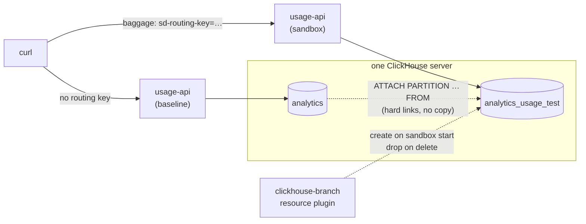

# ClickHouse Database Branching: Isolated Test Data for Every Sandbox

This example gives every [Signadot](https://www.signadot.com/?utm_source=github&utm_medium=readme&utm_campaign=examples&utm_content=clickhouse)
sandbox its own branch of a ClickHouse database. When a sandbox starts, a resource plugin creates
the branch in under a second: a new database on the same ClickHouse server, whose tables are
attached to the source's data parts with `ALTER TABLE ... ATTACH PARTITION ... FROM`. On a local
disk that makes hard links, so no data is copied. The sandbox's copy of your service reads and
writes the branch, everyone else keeps using the shared database, and the branch is dropped when
the sandbox is deleted.



## When you need a ClickHouse branch

The demo is a usage-metering API: it records billable events in an `events` table, a materialized
view rolls them up into `daily_usage`, and the API serves daily counts per customer, the kind of
numbers that feed dashboards and invoices. On a shared staging ClickHouse, testing a change to it
breaks other people's work:

| You're testing | On a shared database | On a branch |
| --- | --- | --- |
| Ingestion code that writes events | Your test rows change everyone's counts | Writes land only in your branch |
| A new rollup or materialized view | Other tests read half-migrated tables | You rebuild it in your branch |
| A schema migration (`ALTER TABLE`) | Every service on staging sees it at once | Only your sandbox sees it |
| A backfill, dedupe or `DELETE` | Shared data is gone for everyone | The source is never touched |
| Tests that assert exact numbers | Flaky, because others write too | Nobody else writes to your branch |

## How the branch is made

ClickHouse has no `CREATE DATABASE ... BRANCH` command, but MergeTree tables make a cheap branch
possible: a table's data lives in immutable parts. Inserts, merges and mutations write new parts
and never change existing ones. So two tables can share the same part files, and a write to
either one only adds new parts to that table. The plugin
([`signadot/clickhouse-branch-plugin.yaml`](signadot/clickhouse-branch-plugin.yaml)) runs three
steps over ClickHouse's HTTP interface:

```sh
# 1. A fresh database for the branch, on the same server as the source.
ch "CREATE DATABASE $BRANCH"

# 2. Each MergeTree table: copy the schema, then attach the newest partitions.
ch "CREATE TABLE $BRANCH.$t AS $SOURCE.$t"
ch "ALTER TABLE $BRANCH.$t ATTACH PARTITION ID '$p' FROM $SOURCE.$t"

# 3. Materialized views, rewritten to read and write the branch's tables.
ch "SELECT create_table_query FROM system.tables
    WHERE database = '$SOURCE' AND engine = 'MaterializedView' FORMAT TSVRaw" |
  sed "s/ $SOURCE\./ $BRANCH./g" | while IFS= read -r ddl; do ch "$ddl"; done
```

The plugin's output is the branch's name, and the sandbox spec
([`signadot/usage-api-sandbox.yaml`](signadot/usage-api-sandbox.yaml)) passes it to the forked
service as `CLICKHOUSE_DATABASE`. The app ([`app.py`](app.py)) has no Signadot code: it reads
whatever database that variable names.

## Before you begin

You need:

- A Kubernetes cluster with the [Signadot Operator](https://www.signadot.com/docs/installation/signadot-operator?utm_source=github&utm_medium=readme&utm_campaign=examples&utm_content=clickhouse) installed.
- The [Signadot CLI](https://www.signadot.com/docs/getting-started/installation/signadot-cli?utm_source=github&utm_medium=readme&utm_campaign=examples&utm_content=clickhouse), logged in with `signadot auth login`.
- `kubectl` pointed at that cluster, and `jq`.
- Docker, and a container registry your cluster can pull from.

This tutorial was tested with Signadot CLI v1.9.1, Operator v1.4.0 and ClickHouse 26.8 on a
Docker Desktop cluster.

## 1. Build the image

```bash
git clone https://github.com/signadot/examples.git
cd examples/clickhouse-branching-tutorial

export IMAGE=docker.io/your-user/clickhouse-branching-demo:latest  # your registry
docker build -t $IMAGE .
docker push $IMAGE
sed -i.orig "s|image: clickhouse-branching-demo:latest|image: $IMAGE|" k8s/usage-api.yaml
```

If your cluster's nodes have a different CPU architecture than your machine (for example an
Apple silicon Mac and an x86 cluster), add `--platform linux/amd64` to `docker build`. On a
local cluster that runs images straight from your Docker daemon, you can skip the push.

## 2. Deploy ClickHouse and the usage API

Start ClickHouse, create the `analytics` database with 59 days of seed events (three monthly
partitions), then start `usage-api`:

```bash
kubectl create namespace clickhouse-demo
kubectl apply -f k8s/clickhouse.yaml
kubectl -n clickhouse-demo wait --for=condition=available deploy/clickhouse --timeout=300s
kubectl -n clickhouse-demo exec -i deploy/clickhouse -- \
  clickhouse-client --password demo-password --multiquery < clickhouse/schema.sql

kubectl apply -f k8s/usage-api.yaml
kubectl -n clickhouse-demo wait --for=condition=available deploy/usage-api --timeout=300s
```

Connect your machine to the cluster, so that cluster service names resolve locally (this asks
for your password):

```bash
export CLUSTER=my-cluster  # your cluster's name, from: signadot cluster list
signadot local connect --cluster=$CLUSTER
```

Define two shortcuts, one for the API and one for ClickHouse's HTTP interface, and read this
week's usage for the customer `acme`:

```bash
API=http://usage-api.clickhouse-demo.svc:8080
ch() { curl -sS -u default:demo-password http://clickhouse.clickhouse-demo.svc:8123 --data-binary "$1"; }

curl -s $API/usage/acme | jq -c '.database, .days[-1]'
```

```
"analytics"
{"day":"2026-11-18","events":207}
```

## 3. Install the resource plugin

```bash
signadot resourceplugin apply -f signadot/clickhouse-branch-plugin.yaml
```

The plugin runs in the `clickhouse-demo` namespace and reads its connection settings from the
same `clickhouse` Secret as the app.

## 4. Create a sandbox with its own branch

```bash
signadot sandbox apply -f signadot/usage-api-sandbox.yaml \
  --set name=usage-test --set cluster=$CLUSTER --set partitions=all
export ROUTING_KEY=$(signadot sandbox get usage-test -o json | jq -r .routingKey)
```

The sandbox is ready in about 10 seconds, most of it starting the forked pod. Compare the two
databases:

```bash
ch "SELECT database, table, groupArray(partition_id) AS partitions, sum(rows) AS rows
    FROM system.parts WHERE database LIKE 'analytics%' AND active
    GROUP BY database, table ORDER BY table, database FORMAT PrettyCompact"
```

```
   ┌─database─────────────┬─table───────┬─partitions──────────────────┬───rows─┐
1. │ analytics            │ daily_usage │ ['202609','202610','202611'] │    180 │
2. │ analytics_usage_test │ daily_usage │ ['202609','202610','202611'] │    180 │
3. │ analytics            │ events      │ ['202609','202610','202611'] │ 300000 │
4. │ analytics_usage_test │ events      │ ['202609','202610','202611'] │ 300000 │
   └──────────────────────┴─────────────┴─────────────────────────────┴────────┘
```

The branch has every partition and every row. Check that none of it was copied: each part file
of `analytics.events` and its counterpart in the branch have the same inode, which means they are
the same file on disk, and each file has two links:

```bash
FILES=$(ch "SELECT path || 'data.bin' FROM system.parts
            WHERE database IN ('analytics', 'analytics_usage_test') AND table = 'events' AND active
            ORDER BY name, database")
kubectl -n clickhouse-demo exec deploy/clickhouse -- stat -c '%i %h %n' $FILES
```

```
1996211 2 /var/lib/clickhouse/store/46c/46c30a13-…/202609_3_3_0/data.bin
1996211 2 /var/lib/clickhouse/store/e98/e981538b-…/202609_3_3_0/data.bin
1996197 2 /var/lib/clickhouse/store/46c/46c30a13-…/202610_2_2_0/data.bin
1996197 2 /var/lib/clickhouse/store/e98/e981538b-…/202610_2_2_0/data.bin
...
```

(If you use zsh, write `$=FILES` so the paths are split into separate arguments.)

## 5. Write test data through the sandbox

Requests with the sandbox's routing key go to the sandbox's `usage-api`. Record three events
for `acme` through it, then read today's count from both versions:

```bash
curl -s -X POST $API/events -H "baggage: sd-routing-key=$ROUTING_KEY" \
  -H 'Content-Type: application/json' \
  -d '[{"customer": "acme"}, {"customer": "acme"}, {"customer": "acme", "event": "export"}]'

curl -s $API/usage/acme -H "baggage: sd-routing-key=$ROUTING_KEY" | jq -c '.database, .days[-1]'
curl -s $API/usage/acme | jq -c '.database, .days[-1]'
```

```
{"database":"analytics_usage_test","inserted":3}
"analytics_usage_test"
{"day":"2026-11-18","events":210}
"analytics"
{"day":"2026-11-18","events":207}
```

The insert went into the branch's `events` table, and the branch's materialized view added it to
the branch's `daily_usage`. The baseline still reports 207.

## 6. Make a destructive change in the branch

Delete all of `acme`'s usage in the branch, the kind of change a backfill or a cleanup job
makes:

```bash
ch "ALTER TABLE analytics_usage_test.daily_usage DELETE WHERE customer = 'acme'
    SETTINGS mutations_sync = 1"

curl -s $API/usage/acme -H "baggage: sd-routing-key=$ROUTING_KEY" | jq -c '.database, .days'
curl -s $API/usage/acme | jq -c '.database, (.days | length)'
```

```
"analytics_usage_test"
[]
"analytics"
7
```

The mutation wrote new parts for the branch's table. The shared part files, and the `analytics`
database, are unchanged.

## 7. Delete the sandbox

```bash
signadot sandbox delete usage-test
ch "SHOW DATABASES LIKE 'analytics%'"
ch "SELECT count() FROM analytics.events"
```

The plugin's delete step ran `DROP DATABASE analytics_usage_test`, which removed only the branch's
links. `analytics` still has all 300,000 events, and its part files are back to one link each.

## Attach only the newest partitions

Attaching a partition makes one hard link per file, so its time depends on the number of parts,
not their size. But a branch of a large table keeps old parts on disk after the source merges or
drops them, for as long as the branch exists. To branch only recent data, set `partitions` to
how many of each table's newest partitions to attach:

```bash
signadot sandbox apply -f signadot/usage-api-sandbox.yaml \
  --set name=usage-latest --set cluster=$CLUSTER --set partitions=1
ch "SELECT table, groupArray(partition_id) FROM system.parts
    WHERE database = 'analytics_usage_latest' AND active GROUP BY table"
signadot sandbox delete usage-latest
```

`events` and `daily_usage` are both partitioned by month, so the branch gets the current month
of each, and the two tables stay consistent.

## FAQ

### Does a ClickHouse branch copy the data?

No. `ATTACH PARTITION ... FROM` between tables on the same disk creates hard links to the
source's part files. A branch uses new disk space only for what it writes, plus the source parts
it keeps alive after the source merges or drops them.

### How long does it take to branch a ClickHouse database?

The plugin's create step finished in under a second here. Its time grows with the number of
parts and partitions, not with the size of the data.

### Can a test in the sandbox damage the shared database?

Not through the branch. MergeTree parts are immutable: inserts, `ALTER TABLE ... DELETE`,
`UPDATE` and schema changes in the branch write new parts for the branch's tables only. Dropping
the branch removes only its links.

### Do I need to pass the routing key to ClickHouse?

No. The sandbox's service connects to its own database, so ClickHouse never sees a routing key.
Signadot routes requests to the sandbox's service with the routing key, and that service picks
the branch through `CLICKHOUSE_DATABASE`.

### What does the plugin copy besides tables?

It copies MergeTree-family tables, with their data, and materialized views. Materialized views
must write to a table named with `TO`, which is ClickHouse's recommended form. Views,
dictionaries and other engines are not copied; add them to the plugin's create step if your
service needs them.

### Does it work on a ClickHouse cluster?

We tested it on a single ClickHouse server. A replicated cluster also needs `ON CLUSTER` and its
own replication path for each branch's tables, which we have not tested.

### How do I use this with my own service?

Point the `clickhouse` Secret at your ClickHouse server, set the sandbox's `database` parameter to
the database your service uses, and give your fork's database setting the plugin's
`createbranch.database` output. In CI, also set the fork's image to the pull request's image.

## Clean up

```bash
signadot resourceplugin delete clickhouse-branch
kubectl delete namespace clickhouse-demo
```

## Next steps

- [ClickHouse branch plugin](https://github.com/signadot/plugins/tree/main/clickhouse): a reusable version of this example's plugin, with install steps for your own ClickHouse server.
- [Database tutorials](https://www.signadot.com/docs/tutorials/databases?utm_source=github&utm_medium=readme&utm_campaign=examples&utm_content=clickhouse): more ways to give each sandbox its own database, and to test schema changes.
- [Resource plugins](https://www.signadot.com/docs/reference/resource-plugins?utm_source=github&utm_medium=readme&utm_campaign=examples&utm_content=clickhouse): the spec this example's plugin uses.
- New to Signadot? [Create a free account](https://www.signadot.com/signup/?utm_source=github&utm_medium=readme&utm_campaign=examples&utm_content=clickhouse) (no credit card), then try it on your own services.
- Questions? Ask in the [Signadot community Slack](https://join.slack.com/t/signadotcommunity/shared_invite/zt-1estxm8pv-qfiaNfiFFCaW~eUlXsVoEQ).
