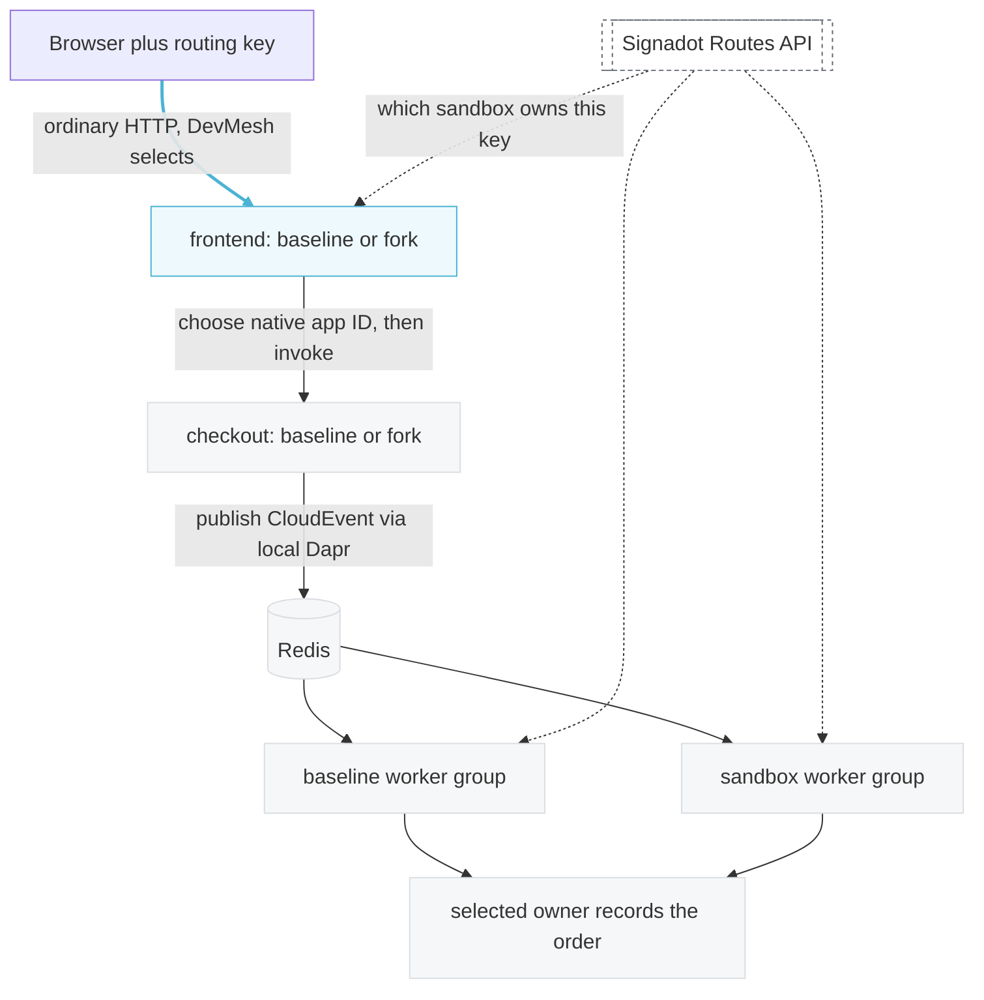

# Dapr Service Sandbox Integration Example

Dapr hides the routing key inside an encrypted message between sidecars, so Signadot cannot route
that hop for you. This example shows how to test a changed Dapr service against a shared baseline
anyway, across both service invocation and pub/sub, without giving up Dapr's native mTLS.

For the guided step-by-step walkthrough, see the
[full tutorial](https://www.signadot.com/docs/tutorials/testing-dapr-services).

## Quick Start

### Prerequisites

- A local **Minikube** profile on **Kubernetes 1.36 or later**, with the
  [Signadot Operator installed](https://www.signadot.com/docs/getting-started/installation). Docker
  Desktop's Kubernetes works too (`--context docker-desktop`, no image load step). This example opts
  its own workloads into DevMesh; nothing extra to install.
- **Dapr 1.18** with mTLS enabled, and a default persistent-volume storage class
- The [Signadot CLI](https://www.signadot.com/docs/reference/cli) installed and authenticated
- `kubectl`, Docker, `minikube`, and Python 3.12
- **The admission rule** in `k8s/dapr-fork-service-label.yaml`, applied once per cluster by someone
  with cluster-admin (see [Fork sidecars](#fork-sidecars)):

  ```bash
  kubectl --context minikube apply -f k8s/dapr-fork-service-label.yaml
  ```

This example does not install or alter either control plane, and `doctor` checks that the rule is
in place before anything is created.

### Deploy

Run these from this directory:

```bash
docker build -t dapr-signadot-tutorial:local app
minikube image load dapr-signadot-tutorial:local

python3 scripts/tutorial.py \
  --context minikube --cluster minikube \
  --name dapr-demo --namespace dapr-demo doctor

python3 scripts/tutorial.py \
  --context minikube --cluster minikube \
  --name dapr-demo --namespace dapr-demo \
  --image dapr-signadot-tutorial:local up
```

`doctor` is read-only and checks the cluster before anything is created; it ends with a single
`OK: ...` verdict line after its JSON report. `up` finishes with `phase: ready` and prints the
preview URLs; run `status` to see them again.

Three things catch people out. Flags go **before** the subcommand. Use a fresh image tag when you
rebuild, or `IfNotPresent` will quietly reuse the old code. And `--cluster` takes the Signadot
cluster name for this profile, from `signadot cluster list`, because `doctor` checks each endpoint on
its own and cannot tell you they point at the same installation.

## What you will see

Each unit costs $12.00. The checkout sandbox applies a 10% discount, and the processor sandbox marks
orders priority. The totals below are for a quantity of 3, matching the tutorial.

| Context | frontend | checkout | order-processor | Total for 3 | Fulfillment |
|---|---|---|---|---|---|
| Baseline | Baseline | Baseline | Baseline | $36.00 | Standard |
| frontend sandbox | **Fork** | Baseline | Baseline | $36.00 | Standard |
| checkout sandbox | Baseline | **Fork** | Baseline | **$32.40** | Standard |
| processor sandbox | Baseline | Baseline | **Fork** | $36.00 | **Priority** |
| Combined RouteGroup | **Fork** | **Fork** | **Fork** | **$32.40** | **Priority** |

**If the frontend column always says Baseline, check how you reached the page.** `kubectl
port-forward` arrives over loopback, which DevMesh does not intercept, so it serves the baseline
frontend no matter which key you send. Open a preview URL instead, or call the Service from a Pod
inside the cluster. Every other column is unaffected, so the port-forward is still fine for
watching checkout and the worker.

## How It Works

1. **Browser to frontend**: ordinary HTTP. Signadot routes this hop transparently, with nothing in
   `app/signadot/` involved.

2. **frontend to checkout**: Dapr carries the routing key inside an mTLS gRPC message where no proxy
   can read it. The caller asks the Routes API which sandbox owns the key, then invokes that
   workload's own Dapr app ID before the request leaves.

3. **Fork identity**: each fork runs under an app ID computed by a naming rule from its sandbox name
   and workload. The caller applies the same rule to the sandbox name the Routes API returns, so
   there is no registry of sandboxes to keep in sync. Dapr's injector gives the fork its own `daprd`,
   so the sidecar-to-sidecar hop keeps its own SPIFFE identity and mTLS, and Dapr's operator creates
   the fork's `<app-id>-dapr` Service.

4. **Checkout to worker**: no routing at all. `consumerID: "{appID}"` gives every app ID its own
   consumer group, so each worker receives every message and decides whether it owns the routing
   context before acting.

5. **Unknown keys fail loud**: when the map has never carried a key, the request is refused rather
   than quietly served from the baseline. An incomplete map and a deleted key look the same from
   here, and guessing wrong cancels someone's sandbox while still reporting success.

For the detailed mechanism and code walkthroughs, see the
[docs tutorial](https://www.signadot.com/docs/tutorials/testing-dapr-services).

## Components

| Component | Purpose |
|---|---|
| **frontend** | Order console and browser entry point, routed by Signadot |
| **checkout** | Prices an order and publishes a CloudEvent, invoked by app ID |
| **order-processor** | Subscribes to `orders`, decides ownership, records the effect |
| **app/signadot/** | The reusable adapter: Routes API client, app-ID naming rule, invocation wrapper, subscription guard |
| **scripts/tutorial.py** | Lifecycle: `doctor`, `up`, `reconcile`, `status`, `down` |
| **scripts/verify.py** | Live acceptance checks against a deployed namespace |
| **k8s/dapr-fork-service-label.yaml** | The cluster-wide admission rule that lets Dapr's injector serve forks |
| **k8s/pr-sandbox.yaml** | A sandbox template for CI jobs and agents: Signadot CLI only, no kubectl |
| **k8s/generated-example/** | A real run's manifests, as `up` generated them |

## Platform vs. Application Code

- **Platform layer** (`app/signadot/`): Routes API client with a polling cache, app-ID naming rule,
  invocation wrapper, subscription guard. No pricing, fulfillment or Redis logic. Implemented once
  by the platform team. `from signadot import ...` is the stable surface.
- **Application code** (`app/checkout/`, `app/order_processor/`, `app/frontend/`): ordinary Dapr
  HTTP code. The integration points are `SignadotDaprClient.invoke` and `SubscriptionGuard.owns`.

`k8s/generated-example/` has the manifests of a real passing run so you can read them without
deploying. Only the Signadot cluster name and the image tag were changed, to the `minikube` and
`dapr-signadot-tutorial:local` these instructions use. They are a record, not something to apply:
the namespace and ownership labels in them are that run's.

## Fork sidecars

A fork needs its own Dapr app ID, because two Deployments sharing one would fight over the same
`<app-id>-dapr` Service. So each sandbox spec sets only `dapr.io/app-id`, and Dapr does the rest:
its injector adds a current `daprd`, and its operator creates the fork's `<app-id>-dapr` Service.

That Service selects the fork's Pods, and the Signadot Operator's fork validation treats any Service
that selects a fork's Pods as a baseline Service, so it rejects the fork with `InvalidCustomization`.
The admission rule in `k8s/dapr-fork-service-label.yaml` prevents that. It labels each Service Dapr
creates for a fork with the fork's own `signadot.com/forked-workload-id`, copied from the Service's
selector, and the validation skips Services carrying that label. Baseline Pods never carry it, so a
labeled Service can only ever select a fork.

- It needs **Kubernetes 1.36 or later**, where `MutatingAdmissionPolicy` is generally available,
  and cluster-admin to apply.
- Remove it only after deleting your sandboxes. Dapr rewrites its Service whenever the fork's
  Deployment changes, and without the rule a running fork is rejected at the next rewrite.
- If that happened, re-apply the rule, then restart the affected fork's Pod so Dapr rewrites its
  Service with the label. For the tutorial's own sandboxes, `reconcile` does that for you; for one
  you created yourself, such as from `k8s/pr-sandbox.yaml`, delete its fork Pod.

## Create a sandbox from CI or an agent

Nothing in a fork's spec has to be read from the cluster, so a CI job or a coding agent can create
one with the Signadot CLI alone. `k8s/pr-sandbox.yaml` forks checkout for one change:

```bash
SANDBOX=pr-123-checkout
APP_ID=$(python3 app/signadot/appid.py --sandbox "$SANDBOX" --namespace dapr-demo --name checkout)
signadot sandbox apply -f k8s/pr-sandbox.yaml \
  --set sandbox="$SANDBOX" --set appID="$APP_ID" --set namespace=dapr-demo \
  --set cluster=minikube --set image=dapr-signadot-tutorial:local
```

Its key reaches the fork as soon as the Routes API carries it, the order console lists it on
reload, and deleting the sandbox removes the fork and its Dapr Service.

## Using the adapter in your own services

`app/signadot/` is the reusable part. It talks plain HTTP to the Dapr sidecar and uses no Dapr SDK,
so it ports to any language with an HTTP client and JSON. `from signadot import ...` is the stable
surface; nothing under it carries pricing, fulfillment or Redis logic.

Wrap your Dapr client once at startup. `AppIDs` holds the baseline app IDs, which change when you
rename a service, not when someone opens a pull request:

```python
from signadot import AppIDs, SignadotDaprClient, Workload

checkout = Workload("Deployment", namespace, "checkout")
app_ids = AppIDs({checkout: "checkout"})
integration = SignadotDaprClient(routes, dapr, app_ids, max_age=60, refresh_seconds=5)

response = await integration.invoke(checkout, "/api/price",
                                    headers=incoming_headers, verb="POST", json=order)
```

Publishing carries the routing context onto the message, and each subscriber gates on ownership
before it reads the business payload:

```python
from signadot import AppIDs, RouteCache, RoutesClient, RoutingError, SubscriptionGuard
from signadot import cloud_event, routing_headers, routing_key, validate_cloud_event
```

### The app-ID naming rule

A fork's app ID is never configured. `fork_app_id` computes it from the sandbox name and the forked
workload, and both sides apply it: whatever creates the sandbox writes the result into the fork's
`dapr.io/app-id` annotation, and a caller applies it to the sandbox name the Routes API returns for
a routing key.

```text
sbx-<sandbox>-<workload>-<8 hex digits of sha256(kind/namespace/name/sandbox)>
sbx-pr-123-checkout-checkout-b7b3ec67
```

The `sbx-` prefix is reserved, so a fork can never take a baseline's app ID. The readable part is
truncated so the whole ID stays within Dapr's 58 characters, and the digest keeps truncated or
ambiguous names apart. `app/signadot/appid.py` uses only the standard library, so a CI job or an
agent creating a sandbox can run it directly:

```bash
python3 app/signadot/appid.py --sandbox pr-123-checkout --namespace dapr-demo --name checkout
```

A sandbox created after the callers started is reachable as soon as the Routes API carries its key,
with nothing to update or restart. The order console lists its routing contexts from the Routes API
too, so a new sandbox appears there on reload.

The [full tutorial](https://www.signadot.com/docs/tutorials/testing-dapr-services) walks through the
same code with the reasoning behind each step.

## Verify

```bash
python3 scripts/verify.py \
  --context minikube --namespace dapr-demo --name dapr-demo \
  --output .state/dapr-demo/evidence/acceptance.json
```

This runs nine checks against the deployed namespace. It waits for the routing map to converge,
walks all five contexts, reads frontend identity from inside the cluster rather than over a
port-forward, and then pushes on the edges: duplicate publishes, a transient failure that succeeds
on retry, a poison message, an incompatible schema that only its owner should reject, and a
malformed routing key. It finishes by inspecting every worker Pod directly to confirm the
non-owning group recorded nothing at all.

A failed assertion exits nonzero and leaves its results behind in the output file.

Runtime dependencies are pinned by hash in `app/requirements.lock`.

## Cleanup

```bash
python3 scripts/tutorial.py \
  --context minikube --cluster minikube \
  --name dapr-demo --namespace dapr-demo down
```

`down` deletes the RouteGroup and sandboxes, then the namespace including the Redis volume, and
refuses to touch resources it does not own. It leaves the admission rule in place; once no sandbox
on the cluster relies on it, remove it with:

```bash
kubectl --context minikube delete -f k8s/dapr-fork-service-label.yaml
```

`reconcile` re-reads the tutorial's sandboxes, restarts any of their forks whose Dapr Service lost
its label, and waits for routing to converge again. It is a no-op when nothing has drifted.

## Architecture



The highlighted hop at the top is the only one Signadot routes for you, and it does that the way it
does for any HTTP service. Everything below it the application routes itself, because Dapr carries the routing key
inside an encrypted sidecar-to-sidecar message. There the application resolves the destination
before invoking, and each worker decides for itself whether it owns an event.

## Next steps

- [Testing Dapr Services with Signadot Sandboxes](https://www.signadot.com/docs/tutorials/testing-dapr-services?utm_source=github&utm_medium=readme&utm_campaign=examples&utm_content=dapr): the full tutorial for this example.
- [Messaging and workflow tutorials](https://www.signadot.com/docs/tutorials/messaging-and-workflows?utm_source=github&utm_medium=readme&utm_campaign=examples&utm_content=dapr): Kafka, RabbitMQ, Amazon SQS, Google Pub/Sub, Redis Streams, Temporal and Dapr.
- New to Signadot? [Create a free account](https://www.signadot.com/signup/?utm_source=github&utm_medium=readme&utm_campaign=examples&utm_content=dapr) (no credit card), then try it on your own services.
- Questions? Ask in the [Signadot community Slack](https://join.slack.com/t/signadotcommunity/shared_invite/zt-1estxm8pv-qfiaNfiFFCaW~eUlXsVoEQ).
