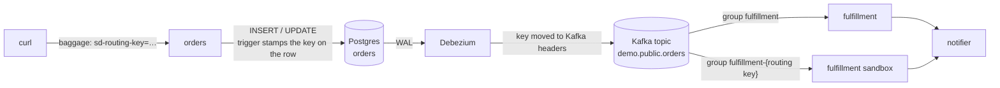

# Change Data Capture (Debezium) with Signadot Sandboxes

Signadot routes a request to a sandbox by its routing key, which travels in request headers.
Change data capture breaks that chain twice. The service that handles the request only writes a
row; it never publishes anything. The event is published later by Debezium, which reads the
database's write-ahead log and has never seen the request. So the routing key has to be stored
with the row, come out of the database with the change, and reach the consumers, which then
decide whether a change event is meant for them.

> **Step-by-step tutorial:** [Test Debezium CDC Pipelines with Sandboxes](https://www.signadot.com/docs/tutorials/testing-debezium-cdc?utm_source=github&utm_medium=readme&utm_campaign=examples&utm_content=debezium-cdc)
> explains how this example works and walks through every step.

This tutorial walks through a small Python app that does that. An `orders` service writes
orders to Postgres, Debezium publishes each change to Kafka, and a `fulfillment` consumer reads
the changes and calls a `notifier`. You'll fork each of the three services into a sandbox, and
watch each change reach exactly the right version of each service. Postgres, Debezium and Kafka
are shared: you never fork them.



## Before you begin

You need:

- A Kubernetes cluster with the [Signadot Operator](https://www.signadot.com/docs/installation/signadot-operator) installed.
- The [Signadot CLI](https://www.signadot.com/docs/getting-started/installation/signadot-cli), logged in with `signadot auth login`.
- `kubectl` pointed at that cluster, and `jq`.
- Docker, and a container registry your cluster can pull from.

This tutorial was tested with Signadot CLI v1.9.0, Operator v1.4.0, Debezium 3.7.1, Kafka 4.1.0
and Postgres 17 on a Docker Desktop cluster.

## 1. Build the image

The three services run from one image. Build it and push it to your registry:

```bash
git clone https://github.com/signadot/examples.git
cd examples/debezium-cdc-tutorial

export IMAGE=docker.io/your-user/debezium-cdc-demo:latest  # your registry
docker build -t $IMAGE .
docker push $IMAGE
```

If your cluster's nodes have a different CPU architecture than your machine (for example an
Apple silicon Mac and an x86 cluster), add `--platform linux/amd64` to `docker build`. On a
local cluster that runs images straight from your Docker daemon, you can skip the push.

## 2. Deploy the demo

Point the manifests at your image, then deploy Postgres, Kafka, Debezium (Kafka Connect) and
the three services. The `migrate` Job creates the schema:

```bash
sed -i.orig "s|image: debezium-cdc-demo:latest|image: $IMAGE|" k8s/*.yaml

kubectl create namespace debezium-demo
kubectl apply -f k8s/
kubectl -n debezium-demo wait --for=condition=complete job/migrate --timeout=300s
kubectl -n debezium-demo wait --for=condition=available deploy --all --timeout=300s
```

Connect your machine to the cluster, so that cluster service names resolve locally (this asks
for your password):

```bash
export CLUSTER=my-cluster  # your cluster's name, from: signadot cluster list
signadot local connect --cluster=$CLUSTER
```

Register the Debezium connector for the `orders` table through the Kafka Connect REST API:

```bash
curl -X PUT http://debezium.debezium-demo.svc:8083/connectors/orders/config \
  -H 'Content-Type: application/json' -d @debezium/orders-connector.json
curl -s http://debezium.debezium-demo.svc:8083/connectors/orders/status | jq .tasks
```

The task's `state` is `RUNNING` after a few seconds.

## 3. How the routing key gets through the database

The app code is plain SQLAlchemy, Flask and `requests`. Everything Signadot-specific lives in
[`platform_cdc/`](platform_cdc/), a small library of the kind a platform team would ship, plus
six lines of connector configuration. App developers don't have to think about sandboxes.

**Into the database.** The `orders` service creates its engine with
`platform_cdc.create_engine`, a drop-in `sqlalchemy.create_engine`, and writes rows as usual
([`app/orders.py`](app/orders.py)):

```python
engine = platform_cdc.create_engine(DATABASE_URL)
...
with engine.begin() as conn:
    conn.execute(text("INSERT INTO orders (id, item, status) VALUES (:id, :item, 'new')"),
                 {"id": order["id"], "item": order["item"]})
```

At the start of every transaction, the engine tells Postgres the current OpenTelemetry context
(`traceparent` and `baggage`, which holds `sd-routing-key`) as transaction-local settings
([`platform_cdc/db.py`](platform_cdc/db.py)). The migration calls `platform_cdc.track_table`
once for each captured table ([`app/migrate.py`](app/migrate.py)):

```python
platform_cdc.track_table(conn, "orders")
```

That adds two columns, `otel_traceparent` and `otel_baggage`, and a trigger that fills them
from those settings on every insert and update. The app's SQL never mentions them.

**Out of the database.** Debezium captures the columns with the rest of the row. Two built-in
transforms in [`debezium/orders-connector.json`](debezium/orders-connector.json) turn them into
the Kafka headers `traceparent` and `baggage`, the same headers a service that published the
event itself would have set:

```json
"transforms": "unwrap,context",
"transforms.unwrap.type": "io.debezium.transforms.ExtractNewRecordState",
"transforms.context.type": "org.apache.kafka.connect.transforms.HeaderFrom$Value",
"transforms.context.fields": "otel_traceparent,otel_baggage",
"transforms.context.headers": "traceparent,baggage",
"transforms.context.operation": "move",
```

**Out of Kafka.** The `fulfillment` service hands a handler to `platform_cdc.ChangeConsumer`
([`app/fulfillment.py`](app/fulfillment.py)):

```python
consumer = platform_cdc.ChangeConsumer(
    KAFKA_BROKERS, topic=ORDERS_TOPIC, group=CONSUMER_GROUP,
    on_ready=lambda: pathlib.Path("/tmp/ready").touch())
consumer.run(handle)
```

[`ChangeConsumer`](platform_cdc/consumer.py) reads the context from the headers and makes it
current while the handler runs, so the handler's call to the notifier carries the key (and so
would a row it writes through the platform engine). It also does the selective consumption:

- The baseline reads through the consumer group `fulfillment`. A sandbox reads through its own
  group, `fulfillment-<routing key>`, which starts at the end of the topic. Every group gets
  every change event.
- It asks the [Signadot Routes API](https://github.com/signadot/routesapi) which routing keys
  belong to sandboxes of the `fulfillment` Deployment. The baseline skips those keys; a sandbox
  processes only its own key and the keys of route groups it's in.

## 4. Create an order without a routing key

```bash
ORDERS=http://orders.debezium-demo.svc:4000
curl -X POST $ORDERS/api/orders -H 'Content-Type: application/json' \
  -d '{"id": "o1", "item": "book"}'
```

Every service writes what it did to an event log that the `orders` service serves. Define a
helper that shows which workload handled each step of an order (the first change event takes a
few seconds, while Debezium creates the topic):

```bash
trail() {
  curl -s $ORDERS/api/events | jq -r --arg id "$1" '.events[]
    | select(.context.orderID == $id)
    | "\(.context.baselineWorkload) (\(.context.sandboxName | if . == "" then "baseline" else . end)): \(.logEntry)"'
}
trail o1
```

```
orders (baseline): Inserted order into Postgres
fulfillment (baseline): Consumed change event (op c) with fulfillment v1: "order o1 (book) is new"
notifier (baseline): Sent notification: "order o1 (book) is new"
```

## 5. Create the sandboxes

Each sandbox forks one service. The fulfillment sandbox also sets `FULFILLMENT_VERSION=v2`, the
"change" under test, which uppercases item names
([`signadot/sandboxes/fulfillment.yaml`](signadot/sandboxes/fulfillment.yaml)). The route group
bundles all three sandboxes under one routing key.

```bash
signadot sandbox apply -f signadot/sandboxes/fulfillment.yaml --set cluster=$CLUSTER
signadot sandbox apply -f signadot/sandboxes/notifier.yaml --set cluster=$CLUSTER
signadot sandbox apply -f signadot/sandboxes/orders.yaml --set cluster=$CLUSTER
signadot routegroup apply -f signadot/routegroups/debezium-demo.yaml --set cluster=$CLUSTER
```

Save the routing keys:

```bash
FULFILLMENT_KEY=$(signadot sandbox get debezium-fulfillment -o json | jq -r .routingKey)
NOTIFIER_KEY=$(signadot sandbox get debezium-notifier -o json | jq -r .routingKey)
ORDERS_KEY=$(signadot sandbox get debezium-orders -o json | jq -r .routingKey)
GROUP_KEY=$(signadot routegroup get debezium-demo -o json | jq -r .routingKey)
```

## 6. Create orders with routing keys

Define a helper that creates an order with a routing key in the `baggage` header, as a preview
URL or the Signadot browser extension would:

```bash
order() {
  curl -s -o /dev/null -X POST $ORDERS/api/orders -H 'Content-Type: application/json' \
    -H "baggage: sd-routing-key=$2" -d "{\"id\": \"$1\", \"item\": \"book\"}"
}
```

**The fulfillment sandbox.** The sandboxed consumer takes the change event and runs v2. The
baseline consumer skips it, and the notifier call goes back to the baseline notifier:

```bash
order o2 $FULFILLMENT_KEY; sleep 2; trail o2
```

```
orders (baseline): Inserted order into Postgres
fulfillment (debezium-fulfillment): Consumed change event (op c) with fulfillment v2: "order o2 (BOOK) is new"
notifier (baseline): Sent notification: "order o2 (BOOK) is new"
```

**The notifier sandbox.** The baseline consumer processes the change event, and its call to
the notifier lands on the sandbox: the routing key made it through Postgres, Debezium and Kafka.

```bash
order o3 $NOTIFIER_KEY; sleep 2; trail o3
```

```
orders (baseline): Inserted order into Postgres
fulfillment (baseline): Consumed change event (op c) with fulfillment v1: "order o3 (book) is new"
notifier (debezium-notifier): Sent notification: "order o3 (book) is new"
```

**The orders sandbox.** The request goes to the sandboxed `orders` service, which writes to the
same table as the baseline, and the baseline consumer handles the change:

```bash
order o4 $ORDERS_KEY; sleep 2; trail o4
```

```
orders (debezium-orders): Inserted order into Postgres
fulfillment (baseline): Consumed change event (op c) with fulfillment v1: "order o4 (book) is new"
notifier (baseline): Sent notification: "order o4 (book) is new"
```

**The route group.** All three sandboxes handle the order:

```bash
order o5 $GROUP_KEY; sleep 2; trail o5
```

```
orders (debezium-orders): Inserted order into Postgres
fulfillment (debezium-fulfillment): Consumed change event (op c) with fulfillment v2: "order o5 (BOOK) is new"
notifier (debezium-notifier): Sent notification: "order o5 (BOOK) is new"
```

**The key belongs to the write, not the row.** Order `o2` was created through the fulfillment
sandbox. Ship it with a request that has no routing key: the trigger clears the stored key, and
the baseline handles this change.

```bash
curl -s -o /dev/null -X POST $ORDERS/api/orders/o2/ship; sleep 2; trail o2 | tail -3
```

```
orders (baseline): Updated order in Postgres
fulfillment (baseline): Consumed change event (op u) with fulfillment v1: "order o2 (book) is shipped"
notifier (baseline): Sent notification: "order o2 (book) is shipped"
```

## 7. Look at each hop

The rows hold the context of the request that last wrote them:

```bash
kubectl -n debezium-demo exec deploy/postgres -- \
  psql -U postgres -d demo -c "SELECT id, status, otel_baggage FROM orders ORDER BY id"
```

```
 id | status  |         otel_baggage
----+---------+------------------------------
 o1 | new     |
 o2 | shipped |
 o3 | new     | sd-routing-key=u5h40ssk4ykjd
 o4 | new     | sd-routing-key=77nkpp3435chn
 o5 | new     | sd-routing-key=mlgky8fm7lb1n
```

In Kafka, the context is in the headers and no longer in the event's value:

```bash
kubectl -n debezium-demo exec deploy/kafka -- /opt/kafka/bin/kafka-console-consumer.sh \
  --bootstrap-server localhost:9092 --topic demo.public.orders --from-beginning \
  --timeout-ms 5000 --property print.headers=true 2>/dev/null | sed 's/__debezium[^,]*,//g'
```

```
...
traceparent:00-de9f...,baggage:sd-routing-key=mlgky8fm7lb1n	{"id":"o5","item":"book","status":"new","__deleted":"false","__op":"c"}
traceparent:00-c9f7...,baggage:null	{"id":"o2","item":"book","status":"shipped","__deleted":"false","__op":"u"}
```

The baseline consumer's log shows each decision, and the sandboxed consumer's log is the
mirror image:

```bash
kubectl -n debezium-demo logs deploy/fulfillment | grep -E "processing|skipped"
kubectl -n debezium-demo logs -l signadot.com/sandbox-routing-key=$FULFILLMENT_KEY --tail=-1 | grep -E "processing|skipped"
```

```
... processing demo.public.orders[0]@0 (routing key None)
... skipped demo.public.orders[0]@1 (routing key 22gurfl1k6v6s)
... processing demo.public.orders[0]@2 (routing key u5h40ssk4ykjd)
... processing demo.public.orders[0]@3 (routing key 77nkpp3435chn)
... skipped demo.public.orders[0]@4 (routing key mlgky8fm7lb1n)
... processing demo.public.orders[0]@5 (routing key None)
```

## Things to know

- **Writes without a context go to the baseline.** A write that doesn't come from a request, or
  from a client that doesn't use the platform engine (a `psql` session, a batch job), clears the
  two columns, so its change event has no routing key.
- **Deletes go to the baseline.** A deleted row has nowhere to store the context of the request
  that deleted it. If sandboxes need to see deletes, use a soft delete (an update), or write the
  event to an outbox table that is tracked the same way.
- **Sandboxes share the database.** A sandboxed `orders` service writes to the baseline's
  table. The stored routing key tells you which rows came from which sandbox.

## 8. Clean up

Delete the route group and the sandboxes:

```bash
signadot routegroup delete debezium-demo
signadot sandbox delete debezium-fulfillment
signadot sandbox delete debezium-notifier
signadot sandbox delete debezium-orders
```

Kafka keeps a consumer group's offsets after its consumer goes away, so the fulfillment
sandbox's group is still there. With a Kafka you keep, delete it yourself:

```bash
kubectl -n debezium-demo exec deploy/kafka -- /opt/kafka/bin/kafka-consumer-groups.sh \
  --bootstrap-server localhost:9092 --delete --group fulfillment-$FULFILLMENT_KEY
```

Then remove the demo and disconnect:

```bash
kubectl delete namespace debezium-demo
signadot local disconnect
```

## Next steps

- [Test Debezium CDC Pipelines with Sandboxes](https://www.signadot.com/docs/tutorials/testing-debezium-cdc?utm_source=github&utm_medium=readme&utm_campaign=examples&utm_content=debezium-cdc): this example as a docs tutorial, with an FAQ.
- [Messaging and workflow tutorials](https://www.signadot.com/docs/tutorials/messaging-and-workflows?utm_source=github&utm_medium=readme&utm_campaign=examples&utm_content=debezium-cdc): Kafka, RabbitMQ, Amazon SQS, Google Pub/Sub, Redis Streams, Temporal and Dapr.
- New to Signadot? [Create a free account](https://www.signadot.com/signup/?utm_source=github&utm_medium=readme&utm_campaign=examples&utm_content=debezium-cdc) (no credit card), then try it on your own services.
- Questions? Ask in the [Signadot community Slack](https://join.slack.com/t/signadotcommunity/shared_invite/zt-1estxm8pv-qfiaNfiFFCaW~eUlXsVoEQ).
