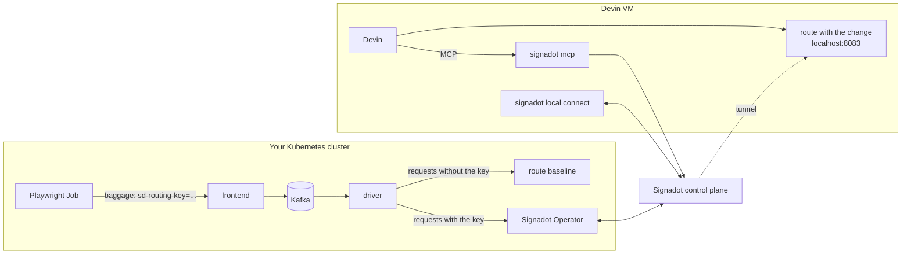

# Validate Devin's Changes End to End with Signadot Sandboxes

[Devin](https://devin.ai) works in its own cloud VM: it clones your repository, writes the change,
and runs the unit tests. What it can't easily do there is prove that a change to one microservice
still works with every other service it talks to. That usually waits for a staging deploy, after
the pull request is open.

This tutorial gives Devin the [Signadot CLI](https://www.signadot.com/docs/getting-started/installation/signadot-cli)
and the [Signadot MCP server](https://www.signadot.com/docs/integrations/mcp) so it can close that
loop itself. Devin changes [HotROD](https://github.com/signadot/hotrod)'s `route` service, runs the
changed service in its VM, and uses the MCP server to create a
[sandbox](https://www.signadot.com/docs/concepts/sandbox) that sends requests carrying the
sandbox's routing key to that process. It then runs HotROD's existing Playwright suite against the
sandbox as a [Signadot Job](https://www.signadot.com/docs/guides/use-cases/run-automated-tests),
inside your cluster, and reports back only after the suite passes.



Two things make this work from a cloud VM:

- **Control-plane connectivity.** The CLI's `ControlPlaneProxy` connection type tunnels through the
  Signadot control plane. Devin's VM needs only an API key: no kubeconfig, and no network path to
  your cluster's API server. That is why the cluster can be a local one on your laptop.
- **A full VM.** Devin's VM has passwordless `sudo`, so `signadot local connect` runs in its
  default privileged mode. In-cluster names such as `redis.hotrod.svc` resolve from the VM, and the
  local service can call its real dependencies.

The tutorial ships three files:

```
devin/blueprint.yaml   Devin environment: Go, Signadot CLI, CLI config, HotROD clone, instructions
prompt.md              the task you give Devin
README.md              this walkthrough
```

## Before you begin

You need:

- A Kubernetes cluster with the [Signadot Operator](https://www.signadot.com/docs/installation/signadot-operator)
  installed. A local cluster such as minikube, kind, k3d or Docker Desktop works, because Devin
  reaches it through the Signadot control plane.
- The [Signadot CLI](https://www.signadot.com/docs/getting-started/installation/signadot-cli) on
  your machine, logged in with `signadot auth login`, and `kubectl` pointed at the cluster.
- A [Devin](https://app.devin.ai) organization where you can edit the environment blueprint and
  add MCP servers (the **Manage MCP Servers** permission).

This tutorial was tested with Signadot CLI v1.9.0, Operator 1.4.0, and Devin's blueprint-based
environment (October 2026).

## 1. Install HotROD and a Playwright runner

Skip the first block if HotROD already runs in the `hotrod` namespace. The files in this tutorial
assume that namespace.

```bash
kubectl create namespace hotrod
kubectl -n hotrod apply -k 'https://github.com/signadot/hotrod/k8s/overlays/prod/devmesh'
kubectl -n hotrod wait --for=condition=available deployment --all --timeout=5m
```

HotROD ships a Playwright suite (`playwright-tests/`) and the Signadot specs to run it. Create the
[job runner group](https://www.signadot.com/docs/reference/jobrunnergroups/spec) that runs the
suite inside the cluster. Its namespace must exist first:

```bash
git clone https://github.com/signadot/hotrod.git
cd hotrod
kubectl create namespace signadot-tests
signadot jobrunnergroup apply -f .signadot/testing/playwright-runner.yaml \
  --set cluster=<your-cluster> --set env=dev
```

Replace `<your-cluster>` with the cluster name you registered in Signadot.

## 2. Create a service account for Devin

In the [Signadot dashboard](https://app.signadot.com), go to **Admin → Service Accounts**, create
one named `devin-tutorial`, and create an API key for it. Copy the key; you will paste it into
Devin twice.

A service account keeps Devin's activity separate from yours. The sandboxes and devboxes Devin
creates belong to `devin-tutorial`, and revoking the key cuts Devin off without touching your own
login.

## 3. Store the key as a Devin secret

In Devin, go to **Settings → Secrets → Add secret**. Create a **Raw** secret named
`SIGNADOT_API_KEY` with the key as its value. Choose **Organization** scope to share it with your
team, or **Personal** to keep it to your own sessions.

The `signadot` CLI reads `SIGNADOT_API_KEY` from its environment. Devin doesn't export secrets into
every shell; it binds them to the commands that need them. The blueprint's instructions tell it
which commands those are.

## 4. Install the Signadot CLI in Devin's environment

Devin builds every session's VM from a snapshot, and a *blueprint* describes what goes into that
snapshot. Open **Settings → Environment → Blueprints → Organization blueprint → Edit** and paste
[`devin/blueprint.yaml`](devin/blueprint.yaml). Before you save, set the two values at the top of
the **Configure Signadot CLI** step to your Signadot org and cluster names:

```yaml
      SIGNADOT_ORG_NAME=my-org
      SIGNADOT_CLUSTER=my-cluster
```

The blueprint has three parts:

- **`initialize`** installs Go and the Signadot CLI, then writes `~/.signadot/config.yaml` with a
  `ControlPlaneProxy` connection to your cluster:

  ```yaml
  org: my-org
  local:
    connections:
    - cluster: my-cluster
      type: ControlPlaneProxy
  ```

  The CLI version is pinned on purpose. Without `SIGNADOT_CLI_VERSION`, the install script asks the
  GitHub API for the latest release, and Devin's shared build IPs hit GitHub's rate limit. The
  script then downloads a release named `null`, and the build fails with `signadot: command not
  found`.
- **`maintenance`** clones HotROD into `~/repos/hotrod` and downloads its Go modules.
- **`knowledge`** is never executed. It is the reference Devin reads before it works: where the
  cluster is, how to connect, how to create the sandbox and how to run the suite. Copy this section
  into your own blueprints when you adapt the tutorial to your services.

Click **Save blueprint**. Devin builds a new snapshot, which takes about two minutes; the page
shows **Last built** when it is ready.

> HotROD is a public repository, so the blueprint clones it with `git`. For your own services,
> connect Devin to GitHub and add the repository under **Repositories** instead. You can then keep
> the blueprint in the repository as `.devin/blueprint.yaml`.

## 5. Add the Signadot MCP server

The Signadot MCP server is a subcommand of the CLI you just installed, so it runs inside Devin's VM
over STDIO. In Devin, go to **Customize → MCPs**, select **Organization**, and choose
**Add MCP → Add custom MCP**:

| Field | Value |
|---|---|
| Server name | `Signadot` |
| Transport type | `STDIO` |
| Command | `signadot` |
| Arguments | `mcp` |
| Environment variables | `SIGNADOT_API_KEY` = `$SIGNADOT_API_KEY` |

Click **Add** and confirm the security notice. The server now shows **Needs connection**: the
`$SIGNADOT_API_KEY` reference created a write-only secret on the server itself, because Devin
doesn't share the secrets from step 3 with MCP servers. Open the server, paste the API key into
the **Secrets** field, and save. The status changes to **Connected**.

Devin can now call tools such as `list_clusters`, `list_devboxes`, `resolve_workload`,
`resolve_workload_port` and `create_sandbox`. The MCP server doesn't have Job tools yet, so Devin
submits the Playwright suite with `signadot job submit`.

## 6. Hand Devin the task

Start a new Devin session and paste [`prompt.md`](prompt.md), with `my-cluster` changed to your
cluster name:

> In ~/repos/hotrod, change the route service so that every computed ETA is exactly 2 minutes
> (services/route/server.go). Keep the FAST_ROUTE override and the rounding logic intact. Smallest
> possible diff.
>
> Before you report back, validate the change end to end against the shared cluster with Signadot
> (see the `signadot` knowledge for commands):
>
> 1. Connect this VM to the cluster with `signadot local connect`.
> 2. Run your modified route service locally on port 8083.
> 3. Use the Signadot MCP to create a sandbox named `devin-route-eta` in cluster `my-cluster` that
>    maps Deployment `route` in namespace `hotrod` to localhost:8083 on this VM's devbox. I approve
>    that spec; no need to ask.
> 4. Run HotROD's Playwright e2e suite against the sandbox as a Signadot Job and wait for it to
>    finish. If it fails, find out why, fix it, and rerun.
> 5. Prove the behavior change: dispatch one ride with the sandbox routing key and one without
>    (baseline), then compare the driver notifications.
>
> Report the diff, the sandbox routing key, the job name and result, and the two notifications.
> Leave the sandbox and the route service running.

Baseline ETAs are random, between 3 and 45 minutes, so an ETA of exactly `2m0s` can only come from
Devin's change. The approval in step 3 matters: the MCP server's `create_sandbox` tool tells agents
to confirm the spec with the user first, and without it Devin stops to ask.

## 7. What Devin does

This section follows a real session against a cluster named `demo` with HotROD in
`hotrod-istio`; your names will differ. It took Devin about eight minutes.

**It makes the change.** Devin edits `services/route/server.go`, then builds and vets the package:

```diff
 	"fmt"
-	"math/rand"
 	"net"
...
-	// Generate a random number between 3 and 45 with decimals
-	eta := time.Duration((rand.Float64()*(45-3) + 3) * float64(time.Minute))
+	eta := 2 * time.Minute
 	if os.Getenv("FAST_ROUTE") != "" {
 		eta = time.Second
 	}
```

**It connects the VM to the cluster.** In this session the first `signadot local connect` was
rejected:

```
Error: 409 Conflict: devbox 63844dd63e40842e592fc3482f76cd44 is already claimed in session 0jzq4z63jvnnd
```

An earlier Devin session that used the same API key was still connected. Devin worked out why:
every Devin VM boots from the same image, so they all share one `/etc/machine-id`, and Signadot
picks the devbox from it. It found that the CLI reads its machine ID from `$MACHINE_ID_FILE` when
that's set, wrote a fresh ID for the session, and connected as a new devbox. That fix is now step 1
of the blueprint's knowledge. `signadot local connect` escalates with `sudo` on its own:

```
signadot local connect has been started ✓
* runtime config: cluster demo, running with root-daemon
✓ Local connection healthy!
    * operator version 1.4.0
    * devbox fc22803c7fc6f3e0afc2ff7f2af87c93 connected
    * control-plane proxy listening at "127.0.0.1:44027"
    * localnet has been configured
    * 51 hosts accessible via /etc/hosts
    * sandboxes watcher is running
```

Then it starts the changed service with `go run ./cmd/hotrod route` in the background.

**It creates the sandbox through the MCP server.** Devin calls `list_clusters`, `resolve_workload`
and `resolve_workload_port` to confirm the Deployment and its port, `list_devboxes` to find its own
devbox, and then `create_sandbox`. The sandbox it created, with empty fields left out:

```yaml
name: devin-route-eta
spec:
  cluster: demo
  description: route service with fixed 2-minute ETA, running locally on Devin VM
  connection:
    devboxId: fc22803c7fc6f3e0afc2ff7f2af87c93
  local:
  - name: local-route
    from:
      kind: Deployment
      namespace: hotrod-istio
      name: route
    mappings:
    - port: 8083
      toLocal: localhost:8083
  defaultRouteGroup:
    endpoints:
    - name: frontend
      target: http://frontend.hotrod-istio.svc:8080
```

From here on, any request in the cluster that carries the sandbox's routing key and reaches
`route` is tunneled to port 8083 in Devin's VM. Everything else still reaches the baseline.

**It runs the Playwright suite as a Job, and the first run fails.** Devin submits HotROD's
[`demo-playwright-job.yaml`](https://github.com/signadot/hotrod/blob/main/.signadot/testing/demo-playwright-job.yaml).
The Job clones HotROD, runs `playwright-tests/basic.spec.ts` in the `playwright` runner group, and
sets `SIGNADOT_ROUTING_KEY` so the suite's requests carry the sandbox's routing key. The tests come
from HotROD's `main` branch; the code under test is the `route` process in Devin's VM. The ride
dispatch goes through `frontend`, Kafka and `driver`, and then to `route` in Devin's VM. One test
fails:

```
Running 2 tests using 1 worker
F·
  1) [chromium] › basic.spec.ts:4:6 › Request a ride › check route resolve routes
    Error: Timed out 5000ms waiting for expect(locator).toHaveText(expected)
    Locator: locator('//div[p[2][contains(text(), \'route\')]]/p[4]')
    Expected string: "Resolving routes"
    Received: <element(s) not found>
  1 failed
  1 passed (17.2s)
```

The passing test shows the ride was dispatched, so the driver did get an ETA back from Devin's
`route`. What's missing is the "Resolving routes" notification, which `route` writes to Redis.

**It finds the cause and fixes it.** Devin reads the Job's log with `signadot logs`, downloads the
Playwright report with `signadot artifact download`, and reads its own `route.log` and HotROD's
config code. `route` defaults to `REDIS_ADDR=redis:6379`. That short name resolves inside the
cluster, but not on the VM, whose `/etc/hosts` has the namespaced names. Devin also pulls the
baseline Deployment's environment with the MCP tool `get_workload_object`, then restarts the
service with in-cluster addresses. No code changes:

```bash
REDIS_ADDR=redis.hotrod-istio.svc:6379 \
SIGNADOT_BASELINE_KIND=Deployment SIGNADOT_BASELINE_NAMESPACE=hotrod-istio \
SIGNADOT_BASELINE_NAME=route SIGNADOT_SANDBOX_NAME=devin-route-eta \
OTEL_EXPORTER_OTLP_ENDPOINT=http://jaeger.hotrod-istio.svc:4318 \
  nohup go run ./cmd/hotrod route > ~/route.log 2>&1 &
```

The second Job passes:

```
Running 2 tests using 1 worker
··
  2 passed (10.3s)
```

**It proves the behavior change.** Devin dispatches one ride with the routing key and one without,
then reads each session's notifications. Its report includes:

```
Sandbox: devin-route-eta in cluster demo, routing key yzjc2jpysz9sq.

Job: hotrod-playwright-e2e-zihjipq succeeded, 2 of 2 tests passed.

Driver notifications (pickup 1, dropoff 123):

With the sandbox key: Driver T792260C arriving in 2m0s
Baseline: Driver T775730C arriving in 8m36s
```

Devin also explained the failed first Job: the local service had been started without the
cluster's settings. It attached the diff as `route-eta.patch`.

**The next session starts where this one ended.** Devin saved what it learned to its memory. A
second session with the same prompt (sandbox `devin-route-eta-2`) ran while the first two Devin VMs
were still connected. It took the per-session machine-ID step from the knowledge and got its own
devbox. It started `route` with the in-cluster Redis address from the start, and the first Job
passed. The session took about three minutes:

```
Sandbox: devin-route-eta-2 in cluster demo ... on this VM's devbox e0eec11beaeddbd4eb9ec6c162a21416
Job: hotrod-playwright-e2e-ggekfhi succeeded (2 passed, 1m12s)
With the routing key: "Driver T718947C arriving in 2m0s"
Without it (baseline): "Driver T743849C arriving in 5m54s"
```

## 8. Check the result yourself

The sandbox and Devin's `route` keep running, so you can repeat the comparison from your machine.
Forward the in-cluster `frontend` and dispatch two rides, one carrying the routing key in the
`baggage` header:

```bash
kubectl -n hotrod port-forward svc/frontend 18080:8080 &

KEY=<routing-key>   # from Devin's report, or: signadot sandbox get devin-route-eta
curl -s -X POST localhost:18080/dispatch -H 'Content-Type: application/json' \
  -H "baggage: sd-routing-key=$KEY" \
  -d '{"SessionID": 7101, "RequestID": 1, "PickupLocationID": 123, "DropoffLocationID": 1}'
curl -s -X POST localhost:18080/dispatch -H 'Content-Type: application/json' \
  -d '{"SessionID": 7102, "RequestID": 2, "PickupLocationID": 123, "DropoffLocationID": 1}'

sleep 10
for s in 7101 7102; do
  curl -s "localhost:18080/notifications?sessionID=$s&cursor=0" \
    | jq -r '.notifications[] | .id + " | rk=" + .context.routingKey + " | " + .body'
done
```

```
req-1-location-resolve | rk=yzjc2jpysz9sq | Resolving locations
req-1-finding-driver | rk=yzjc2jpysz9sq | Finding an available driver
req-1-route-resolve | rk=yzjc2jpysz9sq | Resolving routes
req-1-dispatched-driver | rk=yzjc2jpysz9sq | Driver T771335C arriving in 2m0s
req-2-location-resolve | rk= | Resolving locations
req-2-finding-driver | rk= | Finding an available driver
req-2-route-resolve | rk= | Resolving routes
req-2-dispatched-driver | rk= | Driver T774481C arriving in 7m49s
```

The first ride crossed `frontend`, Kafka and `driver` in the cluster, and its `route` call ran in
Devin's VM. The second never left the baseline.

The Jobs are in the Signadot dashboard under **Validations → Jobs**, with their logs and the
uploaded Playwright report (`hotrod/playwright-report/index.html`, plus a tarball with traces and
videos).

## Cleanup

Ask Devin to delete the sandbox and stop `route` before you end the session, or delete the sandbox
from your machine:

```bash
signadot sandbox delete devin-route-eta
```

`signadot local connect` renews its devbox claim every 30 seconds, so once the Devin VM shuts down
the claim lapses within about a minute. Devboxes that stay idle are removed after 30 days.

## Going further

- **Your own services.** Connect Devin to GitHub, add your repository under
  **Settings → Environment → Repositories**, and commit the blueprint as `.devin/blueprint.yaml`.
  The `knowledge` section is where your team writes down how each service runs outside the cluster:
  its environment variables, ports and dependencies. With that written down, the first Job above
  would have passed, because Devin would have started `route` with `REDIS_ADDR` set.
- **Pull requests with evidence.** Once Devin can push, add "open a pull request and link the
  passing Signadot Job" to the prompt. Reviewers get the e2e result next to the diff. If Devin
  also adds or changes Playwright tests, have it push the branch first and submit the Job with
  `--set branch=<its-branch>`, so the Job runs the new tests.
- **Many sessions in parallel.** The per-session machine ID in the blueprint gives every Devin
  session its own devbox, so parallel sessions can each run their own sandbox with one service
  account.
- **Start sessions from automation.** The [Devin API](https://docs.devin.ai/api-reference/v3/sessions/post-organizations-sessions)
  starts a session from a prompt (`POST /v3/organizations/{org_id}/sessions`), so a ticket or alert
  can kick off the same write, sandbox and test loop.
- **Signadot agent skills.** The [`signadot-validate` skill](https://www.signadot.com/docs/integrations/coding-agents/agent-skills)
  packages this validation loop for agents that load `SKILL.md` files, which Devin does from
  `.agents/skills/` in your repository.

## Troubleshooting

- **Blueprint build fails with `signadot: command not found`.** The install script couldn't
  resolve the latest release (the build log shows a download URL containing `/download/null/`).
  Pin the version with `SIGNADOT_CLI_VERSION`, as the blueprint does.
- **`409 Conflict: devbox ... is already claimed in session ...`.** Another Devin session using
  the same API key holds the devbox. Every Devin VM starts with the same `/etc/machine-id`, so
  without the per-session `MACHINE_ID_FILE` step every session maps to the same devbox. Make sure
  Devin follows step 1 of the knowledge, or end the other session.
- **The MCP server shows "Needs connection".** The `SIGNADOT_API_KEY` secret on the MCP server has
  no value yet. Devin doesn't pass Settings → Secrets to MCP servers, so paste the key on the
  server's page.
- **`list_clusters` asks which cluster to use.** Your org has more than one cluster. Name the
  cluster in the prompt, as `prompt.md` does.
- **The Job fails on "Resolving routes".** `route` in Devin's VM can't reach Redis. Start it with
  `REDIS_ADDR=redis.hotrod.svc:6379`, as in step 7.
- **The driver logs `DeadlineExceeded`.** The driver gives each `route` call one second. Traffic
  between your cluster and Devin's VM goes through the Signadot control plane, which adds latency.
  In our tests, an HTTP request from Devin's VM to an in-cluster service took 20 to 160 ms. If
  your cluster is far from the control plane, run `route` with `ROUTE_CALC_DELAY=1ms` to remove its
  simulated 50 ms of work.
