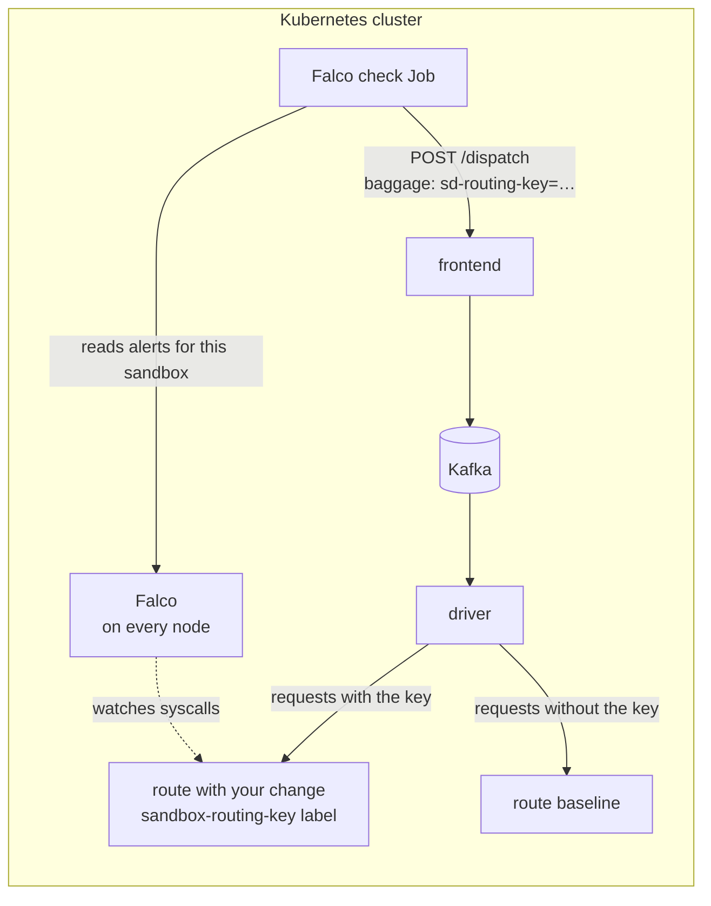

# Catch Risky Runtime Behavior Before Merge with Falco and Signadot Sandboxes

Scanners test what an endpoint returns. Some problems only show up in what the code *does* while
it runs: a new dependency that opens a connection to the internet when it's first used, a handler
that passes input to a shell, code that reads a file it shouldn't. A diff review can miss these,
and so can the unit tests, because nobody wrote a test for behavior nobody expected.

> **Step-by-step tutorial:** [Catch Risky Runtime Behavior with Falco](https://www.signadot.com/docs/tutorials/falco-runtime-security?utm_source=github&utm_medium=readme&utm_campaign=examples&utm_content=falco)
> explains how this example works and walks through every step.

This tutorial runs [Falco](https://falco.org/), the open source runtime security engine, against a
single change before merge. Falco watches system calls on every node in the cluster and raises an
alert when a container does something one of its rules describes. The changed service runs in a
[Signadot sandbox](https://www.signadot.com/docs/concepts/sandbox); everything else it talks to
comes from the cluster's baseline. Signadot labels every sandbox pod with its routing key, so you
can scope Falco's rules to sandbox pods: they fire for your change and stay quiet for normal traffic.

You'll make a change to [HotROD](https://github.com/signadot/hotrod)'s `route` service that computes
a "real" ETA with a small helper package, the way a developer might reach for a third-party library.
On first use, that helper quietly runs a shell command that reaches a host outside the cluster — a
dependency phoning home. A ride dispatch flows `frontend → Kafka → driver → route`, Falco catches the
shell and the outbound connection for the sandboxed `route` only, and a Signadot Job turns that into
a pass/fail. You fix the change and the same Job passes.



## Before you begin

You need:

- A Kubernetes cluster with the [Signadot Operator](https://www.signadot.com/docs/installation/signadot-operator)
  (v1.4.0 or later) installed.
- The [Signadot CLI](https://www.signadot.com/docs/getting-started/installation/signadot-cli),
  logged in with `signadot auth login`. Creating a job runner group requires a Signadot **admin**.
- `kubectl` pointed at that cluster, plus [Helm](https://helm.sh/) and `git`.
- A node whose kernel exposes BTF (`/sys/kernel/btf/vmlinux`), so Falco's modern eBPF driver works.
  Most recent distributions, and Docker Desktop's Kubernetes, have it.

This tutorial was tested with Signadot CLI v1.8.0, Operator 1.4.0, Falco 0.45.0 (chart 9.2.0) on a
Docker Desktop cluster.

## 1. Install HotROD

Skip this step if HotROD already runs in the `hotrod` namespace. The files in this tutorial assume
that namespace.

```bash
kubectl create namespace hotrod
kubectl -n hotrod apply -k 'https://github.com/signadot/hotrod/k8s/overlays/prod/devmesh'
kubectl -n hotrod wait --for=condition=available deployment --all --timeout=5m
```

## 2. Get the tutorial files

```bash
git clone https://github.com/signadot/examples.git signadot-examples
cd signadot-examples/falco-security-tutorial
```

The change itself lives on HotROD's `falco-route-eta` branch and is already built into the public
image `signadot/hotrod:falco-route-eta`, so you don't need to clone or build HotROD. Here's the
core of [the commit](https://github.com/signadot/hotrod/commit/2239d8c49204f30f43987252c3d78bc591975bcb), in
`services/route/server.go`:

```go
// Estimate the ETA from the trip's endpoints using the trafficeta helper,
// instead of returning a random number.
eta := trafficeta.Estimate(req.From, req.To)
```

`trafficeta.Estimate` looks like an ordinary helper. The behavior that matters is one function call
deep, in `services/route/trafficeta/trafficeta.go`, and only happens at runtime:

```go
// fetchTrafficFactor simulates the dependency contacting its backend. It runs a
// shell that reaches an outside host...
func fetchTrafficFactor() {
	cmd := exec.Command("sh", "-c", "wget -q -T 2 -O - "+phoneHomeURL+" || true")
	_ = cmd.Run()
}
```

The ETA comes out right, so the change could pass a review and its unit tests. The files in
`security/`:

| File | What it does |
| --- | --- |
| `falco-values.yaml` | Helm values that install Falco and add two rules scoped to sandbox pods |
| `sandbox.yaml` | A sandbox that forks `route` with your image |
| `falco-reader-rbac.yaml` | A service account that can read Falco's alert logs |
| `falco-runner.yaml` | A job runner group that runs the check Job, using that service account |
| `falco-check.yaml` | The Job: send one dispatch, then pass or fail on Falco's alerts for the sandbox |

## 3. Install Falco with sandbox-scoped rules

Falco sees system calls, not HTTP headers, so the routing key doesn't apply to it the way it does to
a scanner. Instead, you write rules that only match sandbox pods. The Signadot operator already
labels every forked pod with `signadot.com/sandbox-routing-key`, so no extra setup is needed — the
rules in `security/falco-values.yaml` reuse macros and lists from Falco's default ruleset and fire
only for pods that carry that label:

```yaml
customRules:
  signadot_rules.yaml: |-
    - macro: signadot_sandbox_pod
      condition: (k8s.pod.label[signadot.com/sandbox-routing-key] != "")

    - rule: Sandbox Outbound Connection Outside Cluster
      desc: A sandboxed workload connected to an address outside the cluster.
      condition: outbound and container and signadot_sandbox_pod
      output: >
        Sandbox pod connected outside the cluster
        (routing_key=%k8s.pod.label[signadot.com/sandbox-routing-key] pod=%k8s.pod.name ...)
      priority: WARNING
      tags: [signadot, network]

    - rule: Sandbox Shell Spawned
      desc: A process in a sandboxed workload started a shell.
      condition: >
        spawned_process and container and signadot_sandbox_pod
        and proc.name in (shell_binaries)
      output: >
        Shell spawned in sandbox pod
        (routing_key=%k8s.pod.label[signadot.com/sandbox-routing-key] pod=%k8s.pod.name ...)
      priority: WARNING
      tags: [signadot, process]
```

Install Falco, or upgrade an existing release:

```bash
helm repo add falcosecurity https://falcosecurity.github.io/charts
helm repo update
helm upgrade --install falco falcosecurity/falco \
  --namespace falco --create-namespace \
  -f security/falco-values.yaml --wait
```

Wait until the Falco pod is `2/2 Running`:

```bash
kubectl -n falco rollout status ds/falco
```

Baseline pods don't carry the `signadot.com/sandbox-routing-key` label, so these rules stay quiet for
normal traffic and fire only for the code under test. Falco's own default rules still apply to every
pod, as usual.

## 4. Run the change in a sandbox

`security/sandbox.yaml` forks the `route` Deployment with your image. Nothing else is needed: the
operator labels the fork's pods with the sandbox's routing key, which the rules above already match.

```yaml
    customizations:
      images:
      - image: "@{image}"
```

Create the sandbox. Set `CLUSTER` to your cluster's name from `signadot cluster list`:

```bash
export CLUSTER=my-cluster
signadot sandbox apply -f security/sandbox.yaml \
  --set cluster=$CLUSTER \
  --set sandbox=falco-route-eta \
  --set image=signadot/hotrod:falco-route-eta
```

Confirm the fork's pod came up with the routing-key label and your image:

```bash
kubectl -n hotrod get pods -l signadot.com/sandbox-routing-key \
  -o custom-columns=POD:.metadata.name,IMAGE:'.spec.containers[?(@.name=="hotrod")].image'
```

## 5. Set up the check Job

The Job sends one request and then reads Falco's alerts, so its runner needs read access to Falco's
logs. `security/falco-reader-rbac.yaml` creates a `falco-reader` service account in `signadot-tests`
and a Role, scoped to the `falco` namespace, that lets it read Falco's pods and their logs:

```bash
kubectl create namespace signadot-tests
kubectl apply -f security/falco-reader-rbac.yaml
```

`security/falco-runner.yaml` is a job runner group that runs Jobs in an image with `kubectl`, `jq`
and `curl`, as that service account:

```yaml
name: falco-check
spec:
  cluster: "@{cluster}"
  namespace: signadot-tests
  image: alpine/k8s:1.31.1
  jobTimeout: 10m
  podTemplate:
    spec:
      serviceAccountName: falco-reader
  scaling:
    manual:
      desiredPods: 1
```

```bash
signadot jobrunnergroup apply -f security/falco-runner.yaml --set cluster=$CLUSTER
```

The first time, the pod pulls its image, which takes a minute or two. Run
`signadot jobrunnergroup get falco-check` until it shows `Status: 1/1 pods ready`.

## 6. Run the check

`security/falco-check.yaml` ties the Job to the sandbox and, with
`trafficManager.injectRoutingKey: auto`, adds the sandbox's routing key to the plain HTTP request it
sends. Its script sends one ride dispatch to the baseline `frontend`, waits for the request to flow
through Kafka to the `route` service, and then keeps only the Falco alerts from this run whose
`signadot.com/sandbox-routing-key` label matches this sandbox's routing key. If there are any, the
Job fails.

```bash
signadot job submit -f security/falco-check.yaml \
  --set sandbox=falco-route-eta \
  --set target=http://frontend.hotrod:8080 \
  --attach
```

`target` is the baseline frontend's address. The routing key, not the address, decides that the
sandboxed `route` handles the request. After about 30 seconds, the Job fails:

```
Exercising sandbox 'falco-route-eta' (routing key: k6qxtz2h7df7u)
dispatch HTTP 200
Waiting for the request to reach the route service...
Reading Falco alerts for routing key 'k6qxtz2h7df7u'...

Falco raised 4 alert(s) for this sandbox:
      3   [Warning] Sandbox Outbound Connection Outside Cluster
      1   [Warning] Sandbox Shell Spawned

Details:
... Shell spawned in sandbox pod (routing_key=k6qxtz2h7df7u ... shell=sh parent=hotrod
    cmdline=sh -c wget -q -T 2 -O - https://example.com/traffic/v1/factor || true ...)
... Sandbox pod connected outside the cluster (routing_key=k6qxtz2h7df7u ...
    connection=10.244.0.62:34008->104.20.23.154:443 proc=wget ...)
Error: exit status 1
```

The sandboxed `route` spawned a shell and connected to a host outside the cluster while it handled
the dispatch — behavior the diff didn't show and no test checked for. The list of alerts is also
uploaded as a Job artifact (`/tmp/falco-alerts.jsonl`), which you can open from the Job's page in the
Signadot dashboard.

## 7. Fix it and check again

The fix drops the phone-home and computes the ETA in process. It's
[one commit](https://github.com/signadot/hotrod/commit/0c04fae2eaa6bea8ae1c7badacc1c6fcad1df37c) on the
`falco-route-eta-fix` branch, built into `signadot/hotrod:falco-route-eta-fix`. Point the sandbox at
the fixed image:

```bash
signadot sandbox apply -f security/sandbox.yaml \
  --set cluster=$CLUSTER \
  --set sandbox=falco-route-eta \
  --set image=signadot/hotrod:falco-route-eta-fix
```

Run the same check:

```bash
signadot job submit -f security/falco-check.yaml \
  --set sandbox=falco-route-eta \
  --set target=http://frontend.hotrod:8080 \
  --attach
```

This time the request still flows all the way to `route`, but nothing fires, and the Job passes:

```
Exercising sandbox 'falco-route-eta' (routing key: k6qxtz2h7df7u)
dispatch HTTP 200
Waiting for the request to reach the route service...
Reading Falco alerts for routing key 'k6qxtz2h7df7u'...
No Falco alerts for this sandbox. The change is clean.
```

The change is ready for review, and the passing check is evidence that it behaves at runtime.

## Keep the check contained

This check only *observes*: it sends one ordinary dispatch and reads Falco's alerts. It doesn't send
attack payloads, so it's safe to run against a sandbox whose calls to baseline services and shared
databases are real. For your own services:

- **Scope the rules to the sandbox.** The `signadot_sandbox_pod` macro keeps the rules off baseline
  pods, so a dependency the service already had doesn't alert on every change.
- **Tune out behavior the service already does.** The first run can show calls the service already
  made, such as a payment provider, or an entrypoint that starts a shell. Add exceptions to the
  rule conditions, for example `and not fd.sip in (...)` or `and not proc.pname in (...)`, so each
  remaining alert is new. Pod labels apply to every container in the pod, including mesh sidecars;
  add `and container.name = <your-container>` to limit a rule to your application.
- **Drive the paths you care about.** Falco only sees the code paths that run. Exercise the change
  with the tests you already have — a [testing framework](https://www.signadot.com/docs/guides/testing-frameworks),
  or a [ZAP scan](https://github.com/signadot/examples/tree/main/zap-security-tutorial), whose
  requests also reach error paths that functional tests skip.

A coding agent can run this same Job after its tests, read the alerts, and fix the change or explain
the behavior in its PR. The same Job also runs as a pull-request check in CI.

## Clean up

```bash
signadot sandbox delete falco-route-eta
signadot jobrunnergroup delete falco-check
kubectl delete -f security/falco-reader-rbac.yaml
helm uninstall falco -n falco
```

To remove HotROD, run `kubectl delete namespace hotrod`.

## Troubleshooting

| What you see | What to check |
| --- | --- |
| The Falco pod is `CrashLoopBackOff` with a driver error | Your kernel may not support the modern eBPF driver. Check that `/sys/kernel/btf/vmlinux` exists on the node. See [Falco's driver docs](https://falco.org/docs/setup/kubernetes/). |
| The rules never fire, even on the vulnerable image | Confirm the fork pod carries the label: `kubectl -n hotrod get pod -l signadot.com/sandbox-routing-key`. If Falco shows `<NA>` for the label, your Falco build may not read pod labels from the container runtime; enable the [k8smeta plugin](https://github.com/falcosecurity/plugins/tree/main/plugins/k8smeta). |
| The Job fails with `forbidden` reading Falco logs | `kubectl apply -f security/falco-reader-rbac.yaml` wasn't applied, or the runner group isn't using the `falco-reader` service account. |
| The Job stays queued | The runner pod is still pulling its image, or the node is low on disk. Check `kubectl -n signadot-tests get pods`. |
| The check passes on the vulnerable image | The dispatch may not have reached the sandboxed `route`. Confirm the fork pod is ready and that `location` IDs `123` and `567` exist (they're part of HotROD's seed data). |

## Next steps

- [Catch Risky Runtime Behavior with Falco](https://www.signadot.com/docs/tutorials/falco-runtime-security?utm_source=github&utm_medium=readme&utm_campaign=examples&utm_content=falco): the full tutorial for this example.
- [Security testing tutorials](https://www.signadot.com/docs/tutorials/security-testing?utm_source=github&utm_medium=readme&utm_campaign=examples&utm_content=falco): ZAP and Falco against a single change before merge.
- New to Signadot? [Create a free account](https://www.signadot.com/signup/?utm_source=github&utm_medium=readme&utm_campaign=examples&utm_content=falco) (no credit card), then try it on your own services.
- Questions? Ask in the [Signadot community Slack](https://join.slack.com/t/signadotcommunity/shared_invite/zt-1estxm8pv-qfiaNfiFFCaW~eUlXsVoEQ).
