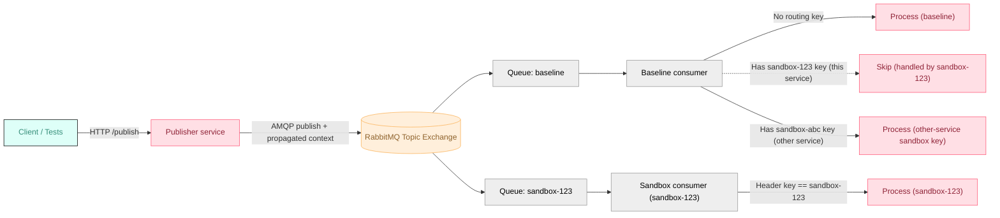

# Testing Microservices with RabbitMQ using Signadot Sandboxes

> **Step-by-step tutorial:** [Testing RabbitMQ Microservices in Kubernetes](https://www.signadot.com/docs/tutorials/testing-rabbitmq-microservices?utm_source=github&utm_medium=readme&utm_campaign=examples&utm_content=rabbitmq)
> walks through this example and explains each consumer's decision rule.

## Introduction

Asynchronous microservices are hard to test: if two versions of a consumer read from the same queue, they compete for messages. Spinning up a separate broker per branch is slow and pricey.

**Signadot Sandboxes** solve this with **request-level isolation**. Keep a single RabbitMQ, but route messages only to the intended version (sandbox) of your consumer using a **sandbox routing key**. Each sandboxed consumer has its own queue binding; baseline traffic remains untouched while you test safely in parallel.

### What you will accomplish:

- Set up a RabbitMQ-based microservices application
- Use routing keys + selective consumption to isolate sandbox traffic
- Deploy services to Kubernetes
- Create Signadot sandboxes for isolated testing
- Test message routing between baseline and sandbox environments

**Time required:** 45-60 minutes

## Prerequisites

Before starting, ensure you have:

1. **A [Signadot account](https://www.signadot.com/signup/?utm_source=github&utm_medium=readme&utm_campaign=examples&utm_content=rabbitmq)** and a Kubernetes cluster with the [Signadot Operator](https://www.signadot.com/docs/installation/signadot-operator) installed
2. **Signadot CLI installed** - Follow the [installation guide](https://www.signadot.com/docs/getting-started/installation/signadot-cli)
3. **kubectl** configured to access your Kubernetes cluster, plus `jq`
4. **Docker** and a container registry, only if you build your own images (Step 2)
5. **RabbitMQ knowledge** - Basic understanding of exchanges, queues, and routing

## Architecture Overview

- A **topic exchange** fans out each message to **both** baseline and sandbox queues.
- **OTel** propagates the sandbox routing key automatically as W3C **baggage**.
- **Selective consumption** in consumers:
    - **Baseline** consumer processes messages **with no routing key**, and **skips** messages whose key belongs to an **active sandbox of this same service**. It still **processes** messages carrying keys for **other services’ sandboxes** or **inactive/unknown** keys.
    - **Sandbox** consumer processes **only** messages with **its own** sandbox key, or the key of a route group that contains its sandbox.

This gives isolation without multiple brokers: everyone receives the message, but only the right consumer acts on it.

### The idea in one picture

Baseline and sandbox consumers each have their own queue bound to the same exchange. Routing keys in headers determine who should act.



## Project structure

```
rabbitmq-signadot-demo/
├── publisher/
│   ├── app.py
│   ├── requirements.txt
│   └── Dockerfile
├── consumer/
│   ├── app.py          
│   ├── requirements.txt
│   └── Dockerfile
├── k8s/
│   ├── namespace.yaml
│   ├── rabbitmq.yaml
│   ├── redis.yaml
│   ├── publisher.yaml
│   └── consumer.yaml 
└── signadot/
    ├── sandboxes/
    │   ├── publisher.yaml
    │   └── consumer.yaml
    └── routegroups/
        └── demo.yaml
```

> You can scaffold this from your own repo or adapt from [Signadot examples](https://github.com/signadot/examples).
> 

## Step 1 – Get the project

Clone the example repository from GitHub:

```bash
git clone https://github.com/signadot/examples.git
cd examples/rabbitmq-signadot-demo
```

Inside the repo you’ll find:

- **publisher/** — Flask app with `/publish` and `/events`. Publishes to a topic exchange and logs events to Redis.
- **consumer/** — Python consumer that declares its own queue, binds to the exchange, and processes messages.
- **k8s/** — manifests for RabbitMQ, Redis, publisher, consumer, and a namespace.
- **signadot/** — sandbox specs for publisher/consumer and a **RouteGroup** to bind them under a single routing key.

## Step 2 — Build and push images (optional)

The manifests run prebuilt images, `ghcr.io/emminex23/rabbitmq-publisher` and
`ghcr.io/emminex23/rabbitmq-consumer`, so you can skip this step to try the demo. Build your own to
run changes to the code, including the consumer's route group support (Step 4), which the prebuilt
consumer image predates:

```bash
# Publisher
docker build -t YOUR_REGISTRY/rabbitmq-publisher:latest ./publisher
docker push YOUR_REGISTRY/rabbitmq-publisher:latest

# Consumer
docker build -t YOUR_REGISTRY/rabbitmq-consumer:latest ./consumer
docker push YOUR_REGISTRY/rabbitmq-consumer:latest
```

Then set the `image:` fields in `k8s/publisher.yaml` and `k8s/consumer.yaml` to your images. The
publisher sandbox runs a `:dev` tag of the publisher image, so push one of those too and update
`signadot/sandboxes/publisher.yaml` to match. `YOUR_REGISTRY` is a placeholder: for images of your
own services, use a private repository and give the cluster pull access, for example with an
[image pull secret](https://kubernetes.io/docs/tasks/configure-pod-container/pull-image-private-registry/).

---

## Step 3 — Deploy the baseline stack

Create namespace and infra:

```bash
kubectl apply -f k8s/namespace.yaml
kubectl apply -n rabbitmq-demo -f k8s/rabbitmq.yaml
kubectl apply -n rabbitmq-demo -f k8s/redis.yaml

kubectl wait --for=condition=ready pod -l app=rabbitmq -n rabbitmq-demo --timeout=120s
kubectl wait --for=condition=ready pod -l app=redis    -n rabbitmq-demo --timeout=60s
```

Deploy services:

```bash
kubectl apply -n rabbitmq-demo -f k8s/publisher.yaml
kubectl apply -n rabbitmq-demo -f k8s/consumer.yaml
```

Verify pods:

```bash
kubectl get pods -n rabbitmq-demo
```

## Step 4 — Connect to Signadot Locally

Use Signadot Local Connect to reach cluster services directly from your local machine:

```bash
export CLUSTER_NAME=<your_signadot_cluster_name>
signadot local connect --cluster=$CLUSTER_NAME
```

Send a baseline message (no sandbox key):

```bash
curl -X POST http://publisher.rabbitmq-demo.svc:8080/publish \
  -H "Content-Type: application/json" \
  -d '{"order_id": "001", "amount": 100, "message": "Baseline order"}'
```

Check:

```bash
kubectl logs -l app=consumer -n rabbitmq-demo --tail=50 | grep PROCESSING
```

You should see baseline processing.


## Step 5 — Create sandboxes and a RouteGroup

Spin up forked workloads for **publisher-v2** and **consumer-v2**. A fork copies its baseline's
environment, so `signadot/sandboxes/consumer.yaml` overrides `QUEUE_NAME`, `QUEUE_DURABLE` and
`QUEUE_AUTO_DELETE` to give the forked consumer its own temporary queue instead of the baseline's:

```bash
export CLUSTER_NAME=<your_registered_cluster>

signadot sandbox apply -f signadot/sandboxes/publisher.yaml --set cluster=$CLUSTER_NAME
signadot sandbox apply -f signadot/sandboxes/consumer.yaml  --set cluster=$CLUSTER_NAME
```

Create a **RouteGroup** that ties them together under one routing key / URL (optional). Messages
sent with the route group's key reach the forked publisher and are processed by the forked consumer,
when the consumer runs an image built from this directory (see Step 2):

```bash
signadot routegroup apply -f signadot/routegroups/demo.yaml --set cluster=$CLUSTER_NAME
signadot routegroup list
```

## Step 6 — Prove isolation

Baseline message (no header → baseline handles it):

```bash
curl -X POST http://publisher.rabbitmq-demo.svc:8080/publish \
  -H "Content-Type: application/json" \
  -d '{"order_id":"002","amount":200,"message":"Baseline order"}'
```


Sandbox message (explicit header → sandbox handles it):

```bash
ROUTING_KEY=$(signadot sandbox get consumer-v2 -o json | jq -r '.routingKey')
echo "Sandbox routing key: $ROUTING_KEY"

curl -X POST http://publisher.rabbitmq-demo.svc:8080/publish \
  -H "Content-Type: application/json" \
  -H "baggage: sd-routing-key=$ROUTING_KEY" \
  -d '{"order_id":"003","amount":300,"message":"Sandbox order"}'
```


Watch logs side-by-side:

- Baseline:

```bash
kubectl logs -f -l app=consumer -n rabbitmq-demo | grep PROCESSING
```


- Sandbox (replace name with your sandbox consumer deployment)

```bash
kubectl logs -f deploy/consumer-v2-dep-consumer-xxxx -n rabbitmq-demo | grep PROCESSING
```


Expected outcome:

- **Baseline** processes **only** messages without a sandbox key or routing key of sandboxes of other services
- **Sandbox** processes **only** messages with its **own** key, or the key of a route group it belongs to

## What’s Happening Under the Hood

- **Context propagation:** When you hit a sandbox URL or pass `sd-routing-key`, the **publisher** attaches that key to message **headers**.
- **Fan-out delivery:** RabbitMQ’s **topic exchange** routes messages to **both** baseline and sandbox queues (via their bindings).
- **Selective consumption:**
    - Baseline consumer **accepts** messages **without** a sandbox key; it **skips** messages with a key that belongs to an **active** sandbox.
    - Sandbox consumer processes **only** messages whose `sd-routing-key` routes to its sandbox: the sandbox's own key, or the key of a route group that contains the sandbox. It asks the Routes API for those keys every 10 seconds.
- **No message loss:** Each sandbox has its **own queue** bound to the exchange. Messages always have a target consumer; baseline only “avoids” messages while a matching sandbox is active.

## Conclusion

You’ve built and deployed a minimal RabbitMQ publisher/consumer stack, forked services into Signadot sandboxes, and confirmed that sandbox routing keys isolate messages in a shared RabbitMQ. This approach scales beyond this demo:

- Works with Kafka, Pub/Sub, or SQS (using analogous header/attribute + selective consumption patterns)
- Supports multiple sandboxes concurrently (e.g., per PR)
- Integrates naturally with CI/CD to spin up ephemeral test envs for each change

## Next steps

- [Testing RabbitMQ Microservices in Kubernetes](https://www.signadot.com/docs/tutorials/testing-rabbitmq-microservices?utm_source=github&utm_medium=readme&utm_campaign=examples&utm_content=rabbitmq): the full tutorial for this example.
- [Messaging and workflow tutorials](https://www.signadot.com/docs/tutorials/messaging-and-workflows?utm_source=github&utm_medium=readme&utm_campaign=examples&utm_content=rabbitmq): the same pattern for Kafka, Amazon SQS, Google Pub/Sub, Redis Streams, Temporal and Dapr.
- New to Signadot? [Create a free account](https://www.signadot.com/signup/?utm_source=github&utm_medium=readme&utm_campaign=examples&utm_content=rabbitmq) (no credit card), then try it on your own services.
- Questions? Ask in the [Signadot community Slack](https://join.slack.com/t/signadotcommunity/shared_invite/zt-1estxm8pv-qfiaNfiFFCaW~eUlXsVoEQ).

Happy testing!