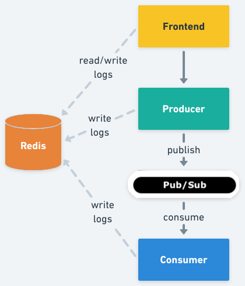

# PubSub Demo - Publish Messages On Demand

This is a sample application to demonstrate how Signadot sandboxes can be used
in the case of cloud-native applications with asynchronous architectures.

> **Step-by-step tutorial:** [Test Google Pub/Sub Flows End to End](https://www.signadot.com/docs/tutorials/testing-google-pub-sub-flows?utm_source=github&utm_medium=readme&utm_campaign=examples&utm_content=google-pub-sub)
> walks through this example scenario by scenario and explains how the subscriber decides which
> messages to process.

This application is formed by three microservices, the `frontend`, the
`publisher`, and the `subscriber`, one Google-managed Pub/Sub topic, and one `Redis` server.

The `frontend` exposes an HTTP server from where static content (HTML, images)
can be accessed, and a minimal REST API with two different methods, one for
publishing a message, and another for getting log entries.

The `publisher` exposes a REST API with a single method that is called from the
frontend, every time a user submits a new message. Upon receiving a request it
publishes the message in `PubSub` with the provided information (by default in
the topic `pubsub-demo`).

The `subscriber` will perform a selective consumption of messages from `PubSub`.
Said selective consumption logic will use the [Signadot Routes
API](https://github.com/signadot/routesapi) (the REST version of it) to get the
required information to define if one message should be processed or not.

The three services from above implement context propagation via `OpenTelemetry`,
and upon receiving requests or consuming messages from `PubSub`, they log those
events in the `Redis` server.

Finally the `frontend` reads those logs and displays them on the UI (the browser
will pull the `frontend` API every two seconds).



## Prerequisites

- A GKE cluster with [Workload Identity](https://cloud.google.com/kubernetes-engine/docs/how-to/workload-identity)
  enabled, and a Google Cloud project with the Pub/Sub API enabled.
- A [Signadot account](https://www.signadot.com/signup/?utm_source=github&utm_medium=readme&utm_campaign=examples&utm_content=google-pub-sub),
  with the [Signadot Operator](https://www.signadot.com/docs/installation/signadot-operator) v0.15.0
  or later installed in the cluster.
- The [Signadot CLI](https://www.signadot.com/docs/getting-started/installation/signadot-cli),
  logged in with `signadot auth login`.
- `kubectl`, `gcloud` logged in to the project, Docker, and a container registry the cluster can
  pull from, such as Artifact Registry.

## Running

Build the demo image and push it to your registry. The frontend, publisher and subscriber all run
from it. Add `PLATFORM=linux/arm64` if your nodes are ARM.

```sh
export IMAGE=<your-registry>/pubsub-demo:latest
make build push IMAGE=$IMAGE
```

Deploy Redis and the three services into the `pubsub-demo` namespace, and point the three
Deployments at your image:

```sh
kubectl create ns pubsub-demo
kubectl -n pubsub-demo apply -f k8s/pieces
for d in frontend publisher subscriber; do
  kubectl -n pubsub-demo set image deployment/$d "*=$IMAGE"
done
```

The publisher and subscriber call Pub/Sub with Google's default credentials, and the subscriber
creates the `pubsub-demo` topic and its subscription on startup. Give them a Google service account
that can do that, through Workload Identity on their Kubernetes service accounts, `publisher` and
`subscriber`:

```sh
export PROJECT_ID=<your-project>
export GSA=pubsub-demo@$PROJECT_ID.iam.gserviceaccount.com

gcloud iam service-accounts create pubsub-demo --project=$PROJECT_ID
gcloud projects add-iam-policy-binding $PROJECT_ID \
  --member="serviceAccount:$GSA" --role=roles/pubsub.editor

for ksa in publisher subscriber; do
  gcloud iam service-accounts add-iam-policy-binding $GSA \
    --project=$PROJECT_ID \
    --role=roles/iam.workloadIdentityUser \
    --member="serviceAccount:$PROJECT_ID.svc.id.goog[pubsub-demo/$ksa]"
  kubectl -n pubsub-demo annotate serviceaccount $ksa iam.gke.io/gcp-service-account=$GSA
done

kubectl -n pubsub-demo rollout restart deployment publisher subscriber
kubectl -n pubsub-demo wait --for=condition=available deployment --all --timeout=5m
```

Sandboxes fork these Deployments with the same service accounts, so forked publishers and
subscribers get the same access.

Create a sandbox for the publisher, one for the subscriber, and a route group that combines them.
Set `CLUSTER` to your cluster's name from `signadot cluster list`:

```sh
export CLUSTER=<your-cluster>
signadot sandbox apply -f signadot/sandboxes/publisher.yaml --set cluster=$CLUSTER
signadot sandbox apply -f signadot/sandboxes/subscriber.yaml --set cluster=$CLUSTER
signadot routegroup apply -f signadot/routegroups/demo.yaml --set cluster=$CLUSTER
```

Install the [Signadot Chrome extension](https://chromewebstore.google.com/detail/signadot/aigejiccjejdeiikegdjlofgcjhhnkim)
and port-forward the `frontend` service:

```sh
kubectl port-forward service/frontend -n pubsub-demo 4000:4000
```

Open a browser at http://localhost:4000/, use the Signadot extension to set your routing context,
and send a message. The log shows which publisher and subscriber handled it. You can also open the
preview URLs that the commands above print, which add the routing key for you.

To uninstall:

```sh
signadot routegroup delete pubsub-demo
signadot sandbox delete publisher-sbx
signadot sandbox delete subscriber-sbx
kubectl delete ns pubsub-demo
gcloud pubsub subscriptions list --project=$PROJECT_ID --filter="topic:pubsub-demo" --format="value(name)" \
  | xargs -r -n1 gcloud pubsub subscriptions delete --project=$PROJECT_ID
gcloud pubsub topics delete pubsub-demo --project=$PROJECT_ID
```

## Next steps

- [Test Google Pub/Sub Flows End to End](https://www.signadot.com/docs/tutorials/testing-google-pub-sub-flows?utm_source=github&utm_medium=readme&utm_campaign=examples&utm_content=google-pub-sub): the full tutorial for this example.
- [Messaging and workflow tutorials](https://www.signadot.com/docs/tutorials/messaging-and-workflows?utm_source=github&utm_medium=readme&utm_campaign=examples&utm_content=google-pub-sub): the same pattern for Kafka, RabbitMQ, Amazon SQS, Redis Streams, Temporal and Dapr.
- New to Signadot? [Create a free account](https://www.signadot.com/signup/?utm_source=github&utm_medium=readme&utm_campaign=examples&utm_content=google-pub-sub) (no credit card), then try it on your own services.
- Questions? Ask in the [Signadot community Slack](https://join.slack.com/t/signadotcommunity/shared_invite/zt-1estxm8pv-qfiaNfiFFCaW~eUlXsVoEQ).
