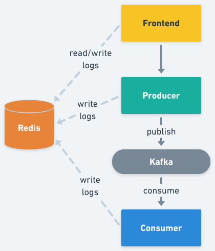

# Kafka Demo - Publish Messages On Demand

This is a sample application to demonstrate how Signadot sandboxes can be used
in the case of cloud-native applications with asynchronous architectures.

> **Step-by-step tutorial:** [Testing Kafka Microservices in Kubernetes](https://www.signadot.com/docs/tutorials/testing-kafka-microservices?utm_source=github&utm_medium=readme&utm_campaign=examples&utm_content=kafka)
> walks through this example and explains consumer groups, selective consumption and offsets.

This application is formed by three microservices, the `frontend`, the
`producer`, and the `consumer`, one `Kafka` cluster, and one `Redis` server.

The `frontend` exposes an HTTP server from where static content (HTML, images)
can be accessed, and a minimal REST API with two different methods, one for
publishing a message, and another for getting log entries.

The `producer` exposes a REST API with a single method that is called from the
frontend, every time a user submits a new message. Upon receiving a request it
publishes the message in `Kafka` with the provided information (by default in
the topic `kafka-demo`).

The `consumer` will perform a selective consumption of messages from `Kafka`.
Said selective consumption logic will use the [Signadot Routes
API](https://github.com/signadot/routesapi) (the REST version of it) to get the
required information to define if one message should be processed or not.

The three services from above implement context propagation via `OpenTelemetry`,
and upon receiving requests or consuming messages from `Kafka`, they log those
events in the `Redis` server.

Finally the `frontend` reads those logs and displays them on the UI (the browser
will pull the `frontend` API every two seconds).




## Running

First, [create a Signadot account](https://www.signadot.com/signup/?utm_source=github&utm_medium=readme&utm_campaign=examples&utm_content=kafka) and
[install the Signadot Operator](https://www.signadot.com/docs/installation/signadot-operator)
if you haven't already.

Second, install the provided manifests in the `k8s` directory

```sh
kubectl create ns kafka-demo
kubectl -n kafka-demo apply -f k8s/pieces
```

Now, create some sandboxes and route groups to perform some tests (replace
`[CLUSTER_NAME]` with your corresponding cluster name):

```sh
signadot sandbox apply -f ./signadot/sandboxes/producer.yaml --set cluster=[CLUSTER_NAME]
signadot sandbox apply -f ./signadot/sandboxes/consumer.yaml --set cluster=[CLUSTER_NAME]
signadot routegroup apply -f ./signadot/routegroups/demo.yaml --set cluster=[CLUSTER_NAME]
```

Once ready, you can test using the generated preview URLs from the above
commands, and/or by accessing the [Signadot
Dashboard](https://app.signadot.com/).


Alternatively, you can install the [Signadot Chrome
extension](https://chromewebstore.google.com/detail/signadot/aigejiccjejdeiikegdjlofgcjhhnkim) and create a
port-forward to the `frontend` service:

```sh
kubectl port-forward service/frontend -n kafka-demo 4000:4000
```

Open a browser at http://localhost:4000/, and use the Signadot extension to set
your routing context.


To uninstall:

```sh
kubectl -n kafka-demo delete -f k8s/pieces
```

## Build from source

The manifests run the prebuilt `signadot/kafka-demo:latest` image. Each sandboxed consumer joins its
own consumer group, named after the baseline's group with the sandbox name appended. The prebuilt
image predates that naming, so its sandboxed consumers share one group, which only matters when you
run more than one consumer sandbox at a time. To run the current code, build the image and point the
Deployments at it:

```sh
export IMAGE=<your-registry>/kafka-demo:latest
docker build --platform linux/amd64 -t $IMAGE .
docker push $IMAGE
for d in frontend producer consumer; do
  kubectl -n kafka-demo set image deployment/$d "*=$IMAGE"
done
```

On Minikube, build inside Minikube's Docker daemon instead (`eval $(minikube docker-env)`) and skip
the push.

## Next steps

- [Testing Kafka Microservices in Kubernetes](https://www.signadot.com/docs/tutorials/testing-kafka-microservices?utm_source=github&utm_medium=readme&utm_campaign=examples&utm_content=kafka): the full tutorial for this example.
- [Messaging and workflow tutorials](https://www.signadot.com/docs/tutorials/messaging-and-workflows?utm_source=github&utm_medium=readme&utm_campaign=examples&utm_content=kafka): the same pattern for RabbitMQ, Amazon SQS, Google Pub/Sub, Redis Streams, Temporal and Dapr.
- New to Signadot? [Create a free account](https://www.signadot.com/signup/?utm_source=github&utm_medium=readme&utm_campaign=examples&utm_content=kafka) (no credit card), then try it on your own services.
- Questions? Ask in the [Signadot community Slack](https://join.slack.com/t/signadotcommunity/shared_invite/zt-1estxm8pv-qfiaNfiFFCaW~eUlXsVoEQ).
