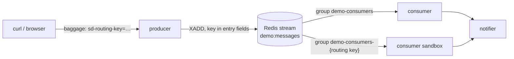
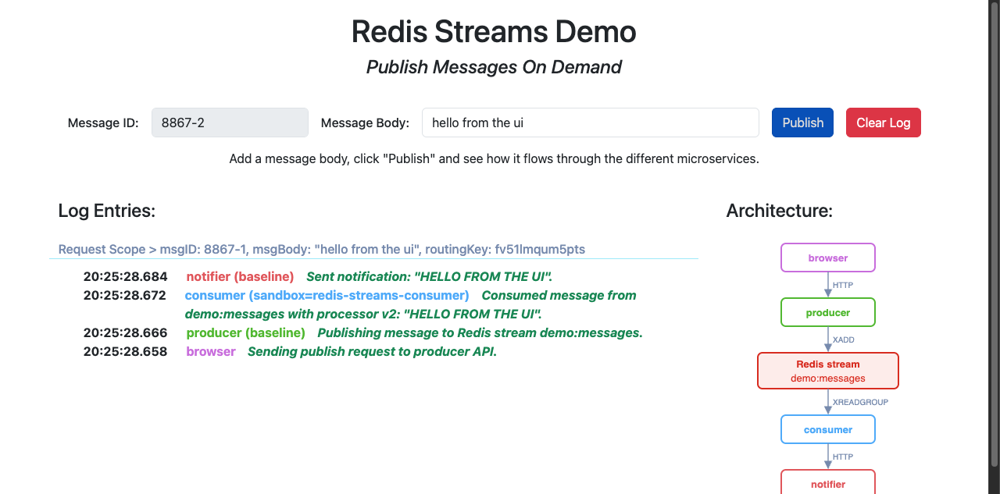

# Redis Streams with Signadot Sandboxes (Python)

Signadot routes a request to a sandbox by its routing key, which travels in request headers. A
Redis stream breaks that chain: nobody calls a consumer, it reads entries on its own. So the
routing key has to travel inside each stream entry, and every consumer, baseline and sandboxed
alike, has to decide whether an entry is meant for it.

> **Step-by-step tutorial:** [Test Redis Streams Consumers with Sandboxes](https://www.signadot.com/docs/tutorials/testing-redis-streams?utm_source=github&utm_medium=readme&utm_campaign=examples&utm_content=redis-streams-python)
> explains how this example works and walks through every step.

This tutorial walks through a small Python app that does that. A producer appends messages to
the Redis stream `demo:messages`, and a consumer reads the stream and calls a notifier. You'll
fork each of the three services into a sandbox, and watch each message reach exactly the right
version of each service.



## Before you begin

You need:

- A Kubernetes cluster with the [Signadot Operator](https://www.signadot.com/docs/installation/signadot-operator) installed.
- The [Signadot CLI](https://www.signadot.com/docs/getting-started/installation/signadot-cli), logged in with `signadot auth login`.
- `kubectl` pointed at that cluster, and `jq`.
- Docker, and a container registry your cluster can pull from.

This tutorial was tested with Signadot CLI v1.9.0, Operator v1.4.0 and Redis 7.4 on a Docker
Desktop cluster.

## 1. Build the image

The three services run from one image. Build it and push it to your registry:

```bash
git clone https://github.com/signadot/examples.git
cd examples/selective-consumption-with-redis-streams/python

export IMAGE=docker.io/your-user/redis-streams-demo-python:latest  # your registry
docker build -t $IMAGE .
docker push $IMAGE
```

If your cluster's nodes have a different CPU architecture than your machine (for example an
Apple silicon Mac and an x86 cluster), add `--platform linux/amd64` to `docker build`. On a
local cluster that runs images straight from your Docker daemon, you can skip the push.

## 2. Deploy the demo

Point the manifests at your image, then deploy Redis and the three services:

```bash
sed -i.orig "s|image: redis-streams-demo-python:latest|image: $IMAGE|" k8s/*.yaml

kubectl create namespace redis-streams-demo
kubectl apply -f k8s/
kubectl -n redis-streams-demo wait --for=condition=available deploy --all --timeout=180s
```

## 3. How the code carries the routing key

The app code is plain redis-py, Flask and `requests`. Everything Signadot-specific lives in
[`platform_redis/`](platform_redis/), a thin wrapper over redis-py of the kind a platform team
would ship, so app developers don't have to think about sandboxes.

The producer uses `platform_redis.Redis`, a drop-in `redis.Redis`
([`app/producer.py`](app/producer.py)):

```python
redis_client = platform_redis.Redis.from_url(REDIS_URL, decode_responses=True)
...
entry_id = redis_client.xadd(STREAM, message, maxlen=10_000, approximate=True)
```

The consumer hands a handler to `platform_redis.StreamConsumer`
([`app/consumer.py`](app/consumer.py)):

```python
consumer = platform_redis.StreamConsumer(
    redis_client, stream=STREAM, group=CONSUMER_GROUP, name=socket.gethostname(),
    on_ready=lambda: pathlib.Path("/tmp/ready").touch())
consumer.run(handle)
```

Underneath, OpenTelemetry carries the routing key on every hop:

- **HTTP**: the Flask and `requests` instrumentation read and forward the `baggage` header,
  which holds `sd-routing-key`.
- **Into Redis**: stream entries have no headers, so
  [`platform_redis.Redis.xadd`](platform_redis/client.py) adds the OpenTelemetry context
  (`traceparent` and `baggage`) to the entry as extra fields.
- **Out of Redis**: [`StreamConsumer`](platform_redis/consumer.py) reads the context back from
  those fields and makes it current while the handler runs, so the handler's call to the
  notifier carries the key too.

`StreamConsumer` also does the selective consumption:

- The baseline reads through the group `demo-consumers`. A sandbox reads through its own group,
  `demo-consumers-<routing key>`, created at `$` so it sees new entries only. Every group gets
  every entry.
- It asks the [Signadot Routes API](https://github.com/signadot/routesapi) which routing keys
  belong to sandboxes of the `consumer` Deployment. The baseline skips those keys; a sandbox
  processes only its own key and the keys of route groups it's in.
- It acknowledges (`XACK`) every entry, processed or skipped, so nothing stays pending.

## 4. Send a message without a routing key

Connect your machine to the cluster, so that cluster service names resolve locally (this asks
for your password):

```bash
export CLUSTER=my-cluster  # your cluster's name, from: signadot cluster list
signadot local connect --cluster=$CLUSTER
```

Publish a message:

```bash
PRODUCER=http://producer.redis-streams-demo.svc:4000
curl -X POST $PRODUCER/api/publish -H 'Content-Type: application/json' \
  -d '{"messageID": "m1", "messageBody": "hello m1"}'
```

Every service writes what it did to an event log that the producer serves. Define a helper that
shows which workload handled each step of a message:

```bash
trail() {
  curl -s $PRODUCER/api/events | jq -r --arg id "$1" '.events[]
    | select(.context.message.id == $id)
    | "\(.context.baselineWorkload.name) (\(.context.sandboxName | if . == "" then "baseline" else . end)): \(.logEntry)"'
}
trail m1
```

```
producer (baseline): Publishing message to Redis stream demo:messages
consumer (baseline): Consumed message from demo:messages with processor v1: "hello m1"
notifier (baseline): Sent notification: "hello m1"
```

## 5. Create the sandboxes

Each sandbox forks one service. The consumer sandbox also sets `PROCESSOR_VERSION=v2`, the
"change" under test, which uppercases message bodies
([`signadot/sandboxes/consumer.yaml`](signadot/sandboxes/consumer.yaml)). The route group
bundles all three sandboxes under one routing key.

```bash
signadot sandbox apply -f signadot/sandboxes/consumer.yaml --set cluster=$CLUSTER
signadot sandbox apply -f signadot/sandboxes/notifier.yaml --set cluster=$CLUSTER
signadot sandbox apply -f signadot/sandboxes/producer.yaml --set cluster=$CLUSTER
signadot routegroup apply -f signadot/routegroups/redis-streams-demo.yaml --set cluster=$CLUSTER
```

Save the routing keys:

```bash
CONSUMER_KEY=$(signadot sandbox get redis-streams-consumer -o json | jq -r .routingKey)
NOTIFIER_KEY=$(signadot sandbox get redis-streams-notifier -o json | jq -r .routingKey)
PRODUCER_KEY=$(signadot sandbox get redis-streams-producer -o json | jq -r .routingKey)
GROUP_KEY=$(signadot routegroup get redis-streams-demo -o json | jq -r .routingKey)
```

## 6. Send messages with routing keys

Define a helper that publishes with a routing key in the `baggage` header, as a preview URL or
the Signadot browser extension would:

```bash
publish() {
  curl -s -o /dev/null -X POST $PRODUCER/api/publish -H 'Content-Type: application/json' \
    -H "baggage: sd-routing-key=$2" -d "{\"messageID\": \"$1\", \"messageBody\": \"hello $1\"}"
}
```

**The consumer sandbox.** The sandboxed consumer takes the message and runs v2. The baseline
consumer skips it, and the notifier call goes back to the baseline notifier:

```bash
publish m2 $CONSUMER_KEY; sleep 1; trail m2
```

```
producer (baseline): Publishing message to Redis stream demo:messages
consumer (redis-streams-consumer): Consumed message from demo:messages with processor v2: "HELLO M2"
notifier (baseline): Sent notification: "HELLO M2"
```

**The notifier sandbox.** The baseline consumer processes the message, and its call to the
notifier lands on the sandbox: the routing key made it through Redis.

```bash
publish m3 $NOTIFIER_KEY; sleep 1; trail m3
```

```
producer (baseline): Publishing message to Redis stream demo:messages
consumer (baseline): Consumed message from demo:messages with processor v1: "hello m3"
notifier (redis-streams-notifier): Sent notification: "hello m3"
```

**The producer sandbox.** The request goes to the sandboxed producer, which publishes to the
same stream as the baseline, and the baseline consumer handles the entry:

```bash
publish m4 $PRODUCER_KEY; sleep 1; trail m4
```

```
producer (redis-streams-producer): Publishing message to Redis stream demo:messages
consumer (baseline): Consumed message from demo:messages with processor v1: "hello m4"
notifier (baseline): Sent notification: "hello m4"
```

**The route group.** All three sandboxes handle the message:

```bash
publish m5 $GROUP_KEY; sleep 1; trail m5
```

```
producer (redis-streams-producer): Publishing message to Redis stream demo:messages
consumer (redis-streams-consumer): Consumed message from demo:messages with processor v2: "HELLO M5"
notifier (redis-streams-notifier): Sent notification: "HELLO M5"
```

Look at the stream's consumer groups:

```bash
kubectl -n redis-streams-demo exec deploy/redis -- redis-cli XINFO GROUPS demo:messages
```

There are two groups, `demo-consumers` and `demo-consumers-<consumer key>`, and both show
`pending` `0`: each group received every entry and acknowledged the ones it skipped. The baseline
consumer's log shows each decision:

```bash
kubectl -n redis-streams-demo logs deploy/consumer | grep -E "processing|skipped"
```

```
... processing 1792725846853-0 (routing key None)
... skipped 1792725891917-0 (routing key fv51lmqum5pts)
... processing 1792725892981-0 (routing key x8nxnyx7xcndj)
... processing 1792725894049-0 (routing key cv8sn8btqsjmw)
... skipped 1792725895106-0 (routing key srud7xvwuckny)
```

The sandboxed consumer's log is the mirror image:

```bash
kubectl -n redis-streams-demo logs -l signadot.com/sandbox-routing-key=$CONSUMER_KEY --tail=-1 | grep -E "processing|skipped"
```

## 7. Try it in the UI

The producer serves a UI that shows each message's trail as it happens. Open
http://producer.redis-streams-demo.svc:4000 (it resolves while `signadot local connect` is
running) and use the
[Signadot browser extension](https://www.signadot.com/docs/guides/developer-environments/access-sandboxes#1-chrome-extension-for-web-applications)
to pick a sandbox or the route group. You can also open the preview URL that
`signadot sandbox apply` printed for each sandbox.



## 8. Clean up

Delete the route group and the sandboxes:

```bash
signadot routegroup delete redis-streams-demo
signadot sandbox delete redis-streams-consumer
signadot sandbox delete redis-streams-notifier
signadot sandbox delete redis-streams-producer
```

Redis doesn't remove a consumer group when its consumer goes away, so the consumer sandbox's
group is still on the stream. With a Redis you keep, delete it yourself:

```bash
kubectl -n redis-streams-demo exec deploy/redis -- \
  redis-cli XGROUP DESTROY demo:messages demo-consumers-$CONSUMER_KEY
```

Then remove the demo and disconnect:

```bash
kubectl delete namespace redis-streams-demo
signadot local disconnect
```

## Next steps

- [Test Redis Streams Consumers with Sandboxes](https://www.signadot.com/docs/tutorials/testing-redis-streams?utm_source=github&utm_medium=readme&utm_campaign=examples&utm_content=redis-streams-python): the full tutorial for this example.
- [Messaging and workflow tutorials](https://www.signadot.com/docs/tutorials/messaging-and-workflows?utm_source=github&utm_medium=readme&utm_campaign=examples&utm_content=redis-streams-python): Kafka, RabbitMQ, Amazon SQS, Google Pub/Sub, Redis Streams, Temporal and Dapr.
- New to Signadot? [Create a free account](https://www.signadot.com/signup/?utm_source=github&utm_medium=readme&utm_campaign=examples&utm_content=redis-streams-python) (no credit card), then try it on your own services.
- Questions? Ask in the [Signadot community Slack](https://join.slack.com/t/signadotcommunity/shared_invite/zt-1estxm8pv-qfiaNfiFFCaW~eUlXsVoEQ).
