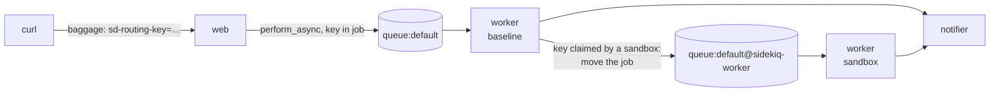

# Test Sidekiq Jobs in Kubernetes with Signadot Sandboxes

A Signadot sandbox runs the version of a service you changed next to the baseline in a shared
Kubernetes cluster, such as staging, and a routing key decides which version handles a request.
Sidekiq breaks that in two ways. Nobody calls a Sidekiq worker: it pulls jobs from Redis. And a
Sidekiq queue gives each job to exactly one worker (`BRPOP`), so there's no consumer group that
would let every version see every job.

This example lets baseline and sandboxed Sidekiq workers share one Redis:

- Each sandboxed worker reads its own queues, such as `default@sidekiq-worker`.
- The baseline worker reads the shared queues. It runs each job, unless a sandbox claims the job's
  routing key; then it moves the job to that sandbox's queue.
- The routing key travels inside each job as OpenTelemetry baggage.

The Signadot-specific code is a small gem, [`signadot_sidekiq`](signadot_sidekiq/), of the kind a
platform team ships. It wraps Sidekiq through Sidekiq's own extension points, server middleware and
startup hooks, because the routing decision happens where jobs are fetched. The job code stays
plain Sidekiq, and services that only enqueue jobs need nothing beyond OpenTelemetry.



The demo has three services. `web` (Sinatra) enqueues `ProcessMessageJob`. The job runs on the
`worker` Deployment and enqueues `NotifyJob` on a second queue. `NotifyJob` calls `notifier`.
You'll fork each service into a sandbox and check where each job runs:

| Job | Runs on |
| --- | --- |
| No routing key | Baseline worker |
| Key of the worker sandbox, or of a route group that includes it | Sandboxed worker |
| Key of the notifier or web sandbox | Baseline worker, and the key still reaches that sandbox |
| Enqueued by another job | Same version as the job that enqueued it |
| Scheduled with `perform_in` | Decided when the job comes due |
| Retry of a failed sandbox job | Back to the sandbox, through the shared queue |
| Left in the queue of a deleted sandbox | Baseline worker, after a 30-second grace period |

## Before you begin

You need:

- A Kubernetes cluster with the [Signadot Operator](https://www.signadot.com/docs/installation/signadot-operator) installed.
- The [Signadot CLI](https://www.signadot.com/docs/getting-started/installation/signadot-cli), logged in with `signadot auth login`.
- `kubectl` pointed at that cluster, and `jq`.
- Docker, and a container registry your cluster can pull from.

This tutorial was tested with Signadot CLI v1.9.0, Operator v1.4.0, Sidekiq 8.1, Ruby 3.4 and
Redis 7.4 on a Docker Desktop cluster.

## 1. Build the image

The three services run from one image. Build it and push it to your registry:

```bash
git clone https://github.com/signadot/examples.git
cd examples/sidekiq-tutorial

export IMAGE=docker.io/your-user/sidekiq-demo:latest  # your registry
docker build -t $IMAGE .
docker push $IMAGE
```

If your cluster's nodes have a different CPU architecture than your machine (for example an
Apple silicon Mac and an x86 cluster), add `--platform linux/amd64` to `docker build`. On a
local cluster that runs images straight from your Docker daemon, you can skip the push.

## 2. Deploy the demo

Point the manifests at your image, then deploy Redis and the three services:

```bash
sed -i.orig "s|image: sidekiq-demo:latest|image: $IMAGE|" k8s/*.yaml

kubectl create namespace sidekiq-demo
kubectl apply -f k8s/
kubectl -n sidekiq-demo wait --for=condition=available deploy --all --timeout=180s
```

## 3. How the code routes jobs

### The app code is plain Sidekiq

The jobs know nothing about sandboxes ([`app/jobs.rb`](app/jobs.rb)):

```ruby
class ProcessMessageJob
  include Sidekiq::Job

  def perform(id, body, fail_once = false)
    # ...
    body = body.upcase if PROCESSOR_VERSION == "v2"
    NotifyJob.perform_async(id, body)
  end
end

class NotifyJob
  include Sidekiq::Job
  sidekiq_options queue: "notifications"
  # ...
end
```

The worker starts like any Sidekiq process, with `sidekiq -r ./app/worker.rb -q default -q
notifications` ([`k8s/worker.yaml`](k8s/worker.yaml)). The one Signadot line is in
[`app/worker.rb`](app/worker.rb); in a Rails app it goes in `config/initializers/sidekiq.rb`:

```ruby
Sidekiq.configure_server do |config|
  SignadotSidekiq.configure(config)
end
```

### OpenTelemetry carries the routing key into each job

[`app/otel.rb`](app/otel.rb) turns on the standard OpenTelemetry instrumentation for Sinatra,
Sidekiq and `Net::HTTP`. Together they carry the W3C `baggage` header, which holds
`sd-routing-key`, through every hop, with no propagation code in the app:

- The Sinatra instrumentation reads it from the incoming request.
- The Sidekiq instrumentation's client middleware writes it into each job when it's pushed,
  including a push from inside another job.
- Its server middleware makes it current again while the job runs.
- The `Net::HTTP` instrumentation adds it to the job's call to the notifier.

A job in Redis carries the key next to its arguments:

```json
{"class":"ProcessMessageJob","queue":"default","args":["m6","hello m6",false],
 "baggage":"sd-routing-key=2t6sgxtcffl9d","traceparent":"00-aad54fc8…-01", …}
```

### `signadot_sidekiq` sends each job to the right worker

The gem does one of two things, depending on where the worker runs.

**In a sandbox** (the Signadot Operator sets `SIGNADOT_SANDBOX_NAME`), it swaps each queue the
worker was started with for the sandbox's own, keeping weights and order
([`signadot_sidekiq.rb`](signadot_sidekiq/lib/signadot_sidekiq.rb)):

```ruby
config.capsules.each_value do |capsule|
  capsule.queues = capsule.weights.map { |queue, weight| [sandbox_queue(queue, sandbox), weight] }
end
```

Nothing has to create these queues. A Sidekiq queue is a Redis list, which appears when the first
job is pushed to it.

**In the baseline** (`SIGNADOT_BASELINE_NAME` is set in [`k8s/worker.yaml`](k8s/worker.yaml)), it
adds a server middleware that runs before every job
([`router.rb`](signadot_sidekiq/lib/signadot_sidekiq/router.rb)):

```ruby
def call(_job_instance, job, queue)
  routing_key = SignadotSidekiq.routing_key(job)
  sandbox = routing_key && @rules.sandbox_for(routing_key)
  return yield unless sandbox

  target = SignadotSidekiq.sandbox_queue(queue, sandbox)
  Sidekiq::Client.push(job.merge("queue" => target, "retry_queue" => job["retry_queue"] || queue))
end
```

The rest of the gem covers what happens around that:

- **Which keys are claimed.** [`RoutingRules`](signadot_sidekiq/lib/signadot_sidekiq/routing_rules.rb)
  asks the [Signadot Routes API](https://github.com/signadot/routesapi) every 5 seconds which
  sandboxes of the `worker` Deployment claim which routing keys. A sandbox claims its own key
  and the keys of the route groups it's in. The baseline runs no job until it has read the rules
  once.
- **Retries.** `retry_queue` makes Sidekiq retry a failed sandbox job on the shared queue, so the
  baseline decides again where the retry runs.
- **Scheduled jobs.** Sidekiq pushes a `perform_in` job to the shared queue when it comes due, so
  the decision happens then, not when the job was scheduled.
- **Deleted sandboxes.** [`Sweeper`](signadot_sidekiq/lib/signadot_sidekiq/sweeper.rb) moves
  jobs left in a deleted sandbox's queues back to the shared queue, 30 seconds after the sandbox
  disappears from the routing rules.

## 4. Enqueue a job without a routing key

Connect your machine to the cluster, so that cluster service names resolve locally (this asks
for your password):

```bash
export CLUSTER=my-cluster  # your cluster's name, from: signadot cluster list
signadot local connect --cluster=$CLUSTER
```

Enqueue a job through the web service:

```bash
WEB=http://web.sidekiq-demo.svc:4000
curl -X POST $WEB/api/messages -H 'Content-Type: application/json' \
  -d '{"id": "m1", "body": "hello m1"}'
```

Every service writes what it did to an event log that the web service serves. Define a helper
that shows which version of each service handled a message:

```bash
trail() {
  curl -s $WEB/api/events | jq -r --arg id "$1" '.[] | select(.messageId == $id)
    | "\(.time[11:19]) \(.service) (\(if .sandbox == "" then "baseline" else .sandbox end)): \(.text)"'
}
trail m1
```

```
07:38:45 web (baseline): Enqueuing ProcessMessageJob
07:38:45 worker (baseline): ProcessMessageJob ran with processor v1: "hello m1"
07:38:45 worker (baseline): NotifyJob ran
07:38:45 notifier (baseline): Sent notification: "hello m1"
```

## 5. Create the sandboxes

Each sandbox forks one service. The worker sandbox also sets `PROCESSOR_VERSION=v2`, the "change"
under test, which uppercases message bodies
([`signadot/sandboxes/worker.yaml`](signadot/sandboxes/worker.yaml)). The route group bundles all
three sandboxes under one routing key.

```bash
signadot sandbox apply -f signadot/sandboxes/worker.yaml --set cluster=$CLUSTER
signadot sandbox apply -f signadot/sandboxes/notifier.yaml --set cluster=$CLUSTER
signadot sandbox apply -f signadot/sandboxes/web.yaml --set cluster=$CLUSTER
signadot routegroup apply -f signadot/routegroups/sidekiq-demo.yaml --set cluster=$CLUSTER
```

Save the routing keys:

```bash
WORKER_KEY=$(signadot sandbox get sidekiq-worker -o json | jq -r .routingKey)
NOTIFIER_KEY=$(signadot sandbox get sidekiq-notifier -o json | jq -r .routingKey)
WEB_KEY=$(signadot sandbox get sidekiq-web -o json | jq -r .routingKey)
GROUP_KEY=$(signadot routegroup get sidekiq-demo -o json | jq -r .routingKey)
```

The sandboxed worker reads its own queues:

```bash
kubectl -n sidekiq-demo logs -l signadot.com/sandbox-routing-key=$WORKER_KEY | grep "reading queues"
```

```
INFO  … sandbox sidekiq-worker: reading queues default@sidekiq-worker, notifications@sidekiq-worker
```

## 6. Enqueue jobs with routing keys

Define a helper that enqueues with a routing key in the `baggage` header, as a preview URL or the
Signadot browser extension would. A third argument adds fields to the request:

```bash
enqueue() {
  curl -s -o /dev/null -X POST $WEB/api/messages -H 'Content-Type: application/json' \
    -H "baggage: sd-routing-key=$2" -d "{\"id\": \"$1\", \"body\": \"hello $1\"${3:+, $3}}"
}
```

**The worker sandbox.** The baseline worker hands both jobs to the sandbox, which runs v2. The
notifier call goes to the baseline notifier:

```bash
enqueue m2 $WORKER_KEY; sleep 2; trail m2
```

```
07:39:13 web (baseline): Enqueuing ProcessMessageJob
07:39:13 worker (sidekiq-worker): ProcessMessageJob ran with processor v2: "HELLO M2"
07:39:13 worker (sidekiq-worker): NotifyJob ran
07:39:13 notifier (baseline): Sent notification: "HELLO M2"
```

**The notifier sandbox.** The baseline worker runs both jobs, and its call to the notifier lands
on the sandbox: the routing key made it through two Redis hops.

```bash
enqueue m3 $NOTIFIER_KEY; sleep 2; trail m3
```

```
07:39:15 web (baseline): Enqueuing ProcessMessageJob
07:39:15 worker (baseline): ProcessMessageJob ran with processor v1: "hello m3"
07:39:15 worker (baseline): NotifyJob ran
07:39:15 notifier (sidekiq-notifier): Sent notification: "hello m3"
```

**The web sandbox.** The sandboxed web service enqueues the job, and the baseline worker runs it:

```bash
enqueue m4 $WEB_KEY; sleep 2; trail m4
```

```
07:39:17 web (sidekiq-web): Enqueuing ProcessMessageJob
07:39:17 worker (baseline): ProcessMessageJob ran with processor v1: "hello m4"
07:39:17 worker (baseline): NotifyJob ran
07:39:17 notifier (baseline): Sent notification: "hello m4"
```

**The route group.** All three sandboxes handle the message:

```bash
enqueue m5 $GROUP_KEY; sleep 2; trail m5
```

```
07:39:19 web (sidekiq-web): Enqueuing ProcessMessageJob
07:39:19 worker (sidekiq-worker): ProcessMessageJob ran with processor v2: "HELLO M5"
07:39:19 worker (sidekiq-worker): NotifyJob ran
07:39:19 notifier (sidekiq-notifier): Sent notification: "HELLO M5"
```

The baseline worker's log shows each hand-off:

```bash
kubectl -n sidekiq-demo logs deploy/worker | grep handed
```

```
INFO  … class=ProcessMessageJob: handed ProcessMessageJob ca29a7c3… (routing key 2t6sgxtcffl9d) to default@sidekiq-worker
INFO  … class=NotifyJob: handed NotifyJob 6311f98d… (routing key 2t6sgxtcffl9d) to notifications@sidekiq-worker
INFO  … class=ProcessMessageJob: handed ProcessMessageJob 9e886289… (routing key 34rqkcc3s4jpw) to default@sidekiq-worker
INFO  … class=NotifyJob: handed NotifyJob 6fa4dbcd… (routing key 34rqkcc3s4jpw) to notifications@sidekiq-worker
```

## 7. Scheduled jobs and retries

Schedule a job 10 seconds out with `perform_in`, and enqueue one whose first attempt fails:

```bash
enqueue m6 $WORKER_KEY '"delay": 10'
enqueue m7 $WORKER_KEY '"failOnce": true'
sleep 30; trail m6; trail m7
```

```
07:39:28 web (baseline): Scheduling ProcessMessageJob in 10s
07:39:43 worker (sidekiq-worker): ProcessMessageJob ran with processor v2: "HELLO M6"
07:39:43 worker (sidekiq-worker): NotifyJob ran
07:39:43 notifier (baseline): Sent notification: "HELLO M6"
07:39:28 web (baseline): Enqueuing ProcessMessageJob
07:39:28 worker (sidekiq-worker): ProcessMessageJob failed on purpose; Sidekiq will retry it
07:39:34 worker (sidekiq-worker): ProcessMessageJob ran with processor v2: "HELLO M7"
07:39:34 worker (sidekiq-worker): NotifyJob ran
07:39:34 notifier (baseline): Sent notification: "HELLO M7"
```

Both ran in the sandbox. When each came due (the scheduled job after 10 seconds, the retry after
its 5-second delay), Sidekiq pushed it to the shared `default` queue, and the baseline handed it to
the sandbox. Had the sandbox been deleted by then, the baseline would have run it.

## 8. Delete a sandbox while its jobs wait

Tell the sandboxed worker to stop taking new jobs, with Sidekiq's quiet signal (`TSTP`), so the
next job waits in its queue:

```bash
kubectl -n sidekiq-demo exec $(kubectl -n sidekiq-demo get pods -o name \
  -l signadot.com/sandbox-routing-key=$WORKER_KEY) -- sh -c 'kill -TSTP 1'

enqueue m8 $WORKER_KEY; sleep 2
kubectl -n sidekiq-demo exec deploy/redis -- redis-cli LLEN queue:default@sidekiq-worker
```

```
1
```

Delete the sandbox. About 30 seconds after the sandbox disappears from the routing rules, the
baseline worker moves the job back to the shared queue and runs it:

```bash
signadot sandbox delete sidekiq-worker
sleep 60; trail m8
```

```
07:40:58 web (baseline): Enqueuing ProcessMessageJob
07:41:41 worker (baseline): ProcessMessageJob ran with processor v1: "hello m8"
07:41:41 worker (baseline): NotifyJob ran
07:41:41 notifier (baseline): Sent notification: "hello m8"
```

```bash
kubectl -n sidekiq-demo logs deploy/worker | grep "is gone"
```

```
INFO  … sandbox sidekiq-worker is gone: moved 1 job(s) from default@sidekiq-worker to default
INFO  … sandbox sidekiq-worker is gone: moved 0 job(s) from notifications@sidekiq-worker to notifications
```

## 9. Clean up

Delete the route group and the remaining sandboxes, then the demo, and disconnect:

```bash
signadot routegroup delete sidekiq-demo
signadot sandbox delete sidekiq-notifier
signadot sandbox delete sidekiq-web

kubectl delete namespace sidekiq-demo
signadot local disconnect
```

With a Redis you keep, there's nothing else to remove: the baseline worker deletes the queues of
deleted sandboxes on its own.

## FAQ

**Can't sandboxed Sidekiq workers read the shared queue and skip jobs that aren't theirs?** No.
Sidekiq fetches with `BRPOP`, which removes the job from Redis. A worker that skipped a job would
lose it.

**Does every service that enqueues jobs need `signadot_sidekiq`?** No. Only Sidekiq worker
processes load it. A service that enqueues jobs needs only the OpenTelemetry Sidekiq
instrumentation, which puts the routing key into each job.

**Do baseline workers restart when sandboxes come and go?** No. They read the routing rules from
the Routes API every 5 seconds.

**How do I use it in a Rails app?** Call `SignadotSidekiq.configure(config)` inside
`Sidekiq.configure_server` in `config/initializers/sidekiq.rb`. The gem uses only Sidekiq's
middleware and lifecycle hooks, nothing from Sinatra or Rails.

**Which Sidekiq versions does it need?** Sidekiq 7.1 or later, for `Capsule#weights`. This
tutorial was tested with Sidekiq 8.1.

## Next steps

- [Messaging and workflow tutorials](https://www.signadot.com/docs/tutorials/messaging-and-workflows?utm_source=github&utm_medium=readme&utm_campaign=examples&utm_content=sidekiq): Kafka, RabbitMQ, Amazon SQS, Google Pub/Sub, Redis Streams, Temporal and Dapr.
- New to Signadot? [Create a free account](https://www.signadot.com/signup/?utm_source=github&utm_medium=readme&utm_campaign=examples&utm_content=sidekiq) (no credit card), then try it on your own services.
- Questions? Ask in the [Signadot community Slack](https://join.slack.com/t/signadotcommunity/shared_invite/zt-1estxm8pv-qfiaNfiFFCaW~eUlXsVoEQ).
