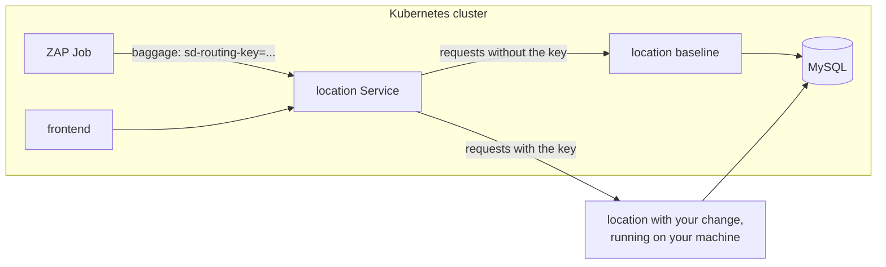

# Catch Security Bugs Before Merge with ZAP and Signadot Sandboxes

Static scanners read code. Some security bugs only show up when the code runs: a query that turns
injectable once real input reaches it, or an error page that leaks database details. Catching those
takes a running target, and in a microservices system that usually means a shared staging
environment, after the change is merged.

> **Step-by-step tutorial:** [Run ZAP DAST Scans on Every Change Before Merge](https://www.signadot.com/docs/tutorials/zap-security-testing?utm_source=github&utm_medium=readme&utm_campaign=examples&utm_content=zap)
> explains how this example works and walks through every step.

This tutorial runs [ZAP](https://www.zaproxy.org/), the open source DAST scanner, against a single
change before merge. The changed service runs in a [Signadot sandbox](https://www.signadot.com/docs/concepts/sandbox),
and everything else it talks to comes from the cluster's baseline. ZAP runs in the cluster as a
[Signadot Job](https://www.signadot.com/docs/guides/use-cases/run-automated-tests), which adds the
sandbox's routing key to every request ZAP sends, so its attacks reach your change and nothing else.

You'll make a change to [HotROD](https://github.com/signadot/hotrod)'s `location` service that adds
search by name, and introduces a SQL injection along with it. ZAP catches it. You fix it and scan
again.



The changed service runs on your machine, so you don't build or push an image, and a fix is one
restart away from its next scan. To scan a change deployed in the cluster instead, see
[Scan a change deployed in the cluster](#scan-a-change-deployed-in-the-cluster). The Job is the same.

## Before you begin

You need:

- A Kubernetes cluster with the [Signadot Operator](https://www.signadot.com/docs/installation/signadot-operator)
  installed.
- The [Signadot CLI](https://www.signadot.com/docs/getting-started/installation/signadot-cli),
  logged in with `signadot auth login`.
- `kubectl` pointed at that cluster, plus `git`, `jq` and Go 1.21 or later. Go downloads the
  toolchain version HotROD asks for.

This tutorial was tested with Signadot CLI v1.8.0, Operator 1.4.0 and ZAP 2.17.0.

## 1. Install HotROD

Skip this step if HotROD already runs in the `hotrod` namespace. The files in this tutorial assume
that namespace.

```bash
kubectl create namespace hotrod
kubectl -n hotrod apply -k 'https://github.com/signadot/hotrod/k8s/overlays/prod/devmesh'
kubectl -n hotrod wait --for=condition=available deployment --all --timeout=5m
```

## 2. Get the change

The change is on HotROD's `zap-location-search` branch. Clone that branch and this repository side
by side, then copy the Signadot files into HotROD:

```bash
git clone https://github.com/signadot/examples.git signadot-examples
git clone -b zap-location-search https://github.com/signadot/hotrod.git
cd hotrod
cp -R ../signadot-examples/zap-security-tutorial/security .signadot/
```

The change adds an optional `name` filter to `GET /locations`. Here's the core of
[the commit](https://github.com/signadot/hotrod/commit/07b84b03713ffec110f925ae35a9ef441cc8a1b4), in
`services/location/database.go`:

```go
query := "SELECT id, name, coordinates FROM locations"
if name != "" {
    query += fmt.Sprintf(" WHERE name LIKE '%%%s%%'", name)
}
rows, err := d.db.Query(query)
```

It returns the right rows for normal input, so it could pass a quick review.

The files you copied into `.signadot/security/`:

| File | What it does |
| --- | --- |
| `sandbox.yaml` | A sandbox that routes requests for the `location` service to port 8081 on your machine |
| `zap-runner.yaml` | A job runner group that runs Jobs in ZAP's official image |
| `zap-api-scan.yaml` | The scan: a ZAP API scan of `GET /locations`, sent with the sandbox's routing key |

## 3. Run the change in a sandbox

Connect your machine to the cluster. `signadot local connect` asks for your password, because it
updates `/etc/hosts` and local networking:

```bash
signadot local connect
```

Create the sandbox. Set `CLUSTER` to your cluster's name from `signadot cluster list`:

```bash
export CLUSTER=my-cluster
signadot sandbox apply -f .signadot/security/sandbox.yaml --set cluster=$CLUSTER
```

In a **second terminal**, in the `hotrod` directory, start the `location` service with your change.
`get-env` loads the baseline's environment, so the service connects to the cluster's MySQL and
Redis:

```bash
eval "$(signadot sandbox get-env location-search)"
go run ./cmd/hotrod location
```

Leave it running. Back in the first terminal, send the same request twice: once as a normal request,
and once with the sandbox's routing key:

```bash
ROUTING_KEY=$(signadot sandbox get location-search -o json | jq -r .routingKey)
curl "http://location.hotrod:8081/locations?name=Coffee"
curl -H "baggage: sd-routing-key=$ROUTING_KEY" "http://location.hotrod:8081/locations?name=Coffee"
```

The first request reaches the baseline, which ignores `name` and returns all five locations. The
second reaches the code on your machine and returns only `Amazing Coffee Roasters`. Both requests go
to the same address. The routing key decides which version handles them.

## 4. Create the ZAP job runner group

The runner group keeps a pod running ZAP's image in your cluster, ready to run scan Jobs:

```yaml
name: zap
spec:
  cluster: "@{cluster}"
  namespace: signadot-tests
  image: ghcr.io/zaproxy/zaproxy:stable
  jobTimeout: 15m
  scaling:
    manual:
      desiredPods: 1
```

Create its namespace, then the runner group:

```bash
kubectl create namespace signadot-tests
signadot jobrunnergroup apply -f .signadot/security/zap-runner.yaml --set cluster=$CLUSTER
```

The first time, the pod pulls ZAP's image, which takes a minute or two. Run
`signadot jobrunnergroup get zap` until it shows `Status: 1/1 pods ready`.

## 5. Scan the sandbox

`zap-api-scan.yaml` does three things.

It writes a small OpenAPI definition that lists only `GET /locations` and its `name` parameter.
ZAP's API scan sends attack payloads to each operation in the definition, so the scan covers exactly
what changed and leaves out operations that write data.

It ties the Job to the sandbox and has Signadot add the sandbox's routing key to every request ZAP
sends:

```yaml
routingContext:
  sandbox: "@{sandbox}"
trafficManager:
  injectRoutingKey: auto
```

With `injectRoutingKey: auto`, a proxy next to the Job adds the routing headers to its outbound
plain HTTP traffic. ZAP needs no extra configuration, and its own header settings stay free for
your app's credentials if the scan needs to log in.

And it fails the Job if ZAP reports anything High risk. Low-risk findings, like missing security
headers, show up in the report but don't fail the Job.

Run the scan:

```bash
signadot job submit -f .signadot/security/zap-api-scan.yaml \
  --set sandbox=location-search \
  --set target=http://location.hotrod:8081 \
  --attach
```

`target` is the baseline service's address. ZAP never needs to know where your change runs. After
about 30 seconds, the Job fails:

```
WARN-NEW: SQL Injection [40018] x 1
	http://location.hotrod:8081/locations?name=%27 (500 Internal Server Error)
...
FAIL-NEW: 0	FAIL-INPROG: 0	WARN-NEW: 4	WARN-INPROG: 0	INFO: 0	IGNORE: 0	PASS: 116

ZAP found 1 High-risk issue(s):
  SQL Injection [40018]: param name, attack '
Error: exit status 1
```

ZAP sent a single quote as `name`, and the service answered with a server error. A harmless value
didn't cause one. Send the same request yourself to see why:

```bash
curl -H "baggage: sd-routing-key=$ROUTING_KEY" "http://location.hotrod:8081/locations?name='"
```

```
Error 1064 (42000): You have an error in your SQL syntax; check the manual that corresponds to your MariaDB server version for the right syntax to use near ''' at line 1
```

The quote ended the SQL string early. Whatever follows it in `name` runs as SQL, and the error
message gives away the database. The full report has a description and a fix for each finding.
Download it with the Job name from the output above:

```bash
signadot artifact download --job <job-name> /zap/wrk/zap-report.html
```

You can also open both reports from the Job's page in the Signadot dashboard.

## 6. Fix it and scan again

The fix passes `name` to the database as a query parameter instead of pasting it into the SQL.
It's [one commit](https://github.com/signadot/hotrod/commit/6a5c918c436260d0b3baa775cdd9f835788a65b2)
on the `zap-location-search-fix` branch:

```go
query := "SELECT id, name, coordinates FROM locations"
var args []any
if name != "" {
    query += " WHERE name LIKE ?"
    args = append(args, "%"+name+"%")
}
rows, err := d.db.Query(query, args...)
```

Switch to that branch:

```bash
git checkout zap-location-search-fix
```

In the second terminal, stop the service with Ctrl+C and start it again:

```bash
go run ./cmd/hotrod location
```

Scan again:

```bash
signadot job submit -f .signadot/security/zap-api-scan.yaml \
  --set sandbox=location-search \
  --set target=http://location.hotrod:8081 \
  --attach
```

This time the Job passes:

```
FAIL-NEW: 0	FAIL-INPROG: 0	WARN-NEW: 2	WARN-INPROG: 0	INFO: 0	IGNORE: 0	PASS: 117
No High-risk issues found.
```

The single quote is now just a character to search for. It finds `Rachel's Floral Designs`:

```bash
curl -H "baggage: sd-routing-key=$ROUTING_KEY" "http://location.hotrod:8081/locations?name='"
```

The change is ready for review, and the passing scan is evidence that it's safe to merge.

## Scan a change deployed in the cluster

The sandbox decides where the change runs, so the Job works the same way when the change is deployed
in the cluster. Build an image from your branch, then create a sandbox that forks the `location`
Deployment with that image in place of `local`:

```yaml
name: location-search
spec:
  cluster: "@{cluster}"
  forks:
    - forkOf:
        kind: Deployment
        namespace: hotrod
        name: location
      customizations:
        images:
          - image: "@{image}"
```

Then run the same `signadot job submit` command. That's also how you'd run the scan from your CI
pipeline for each pull request.

## Keep active scans contained

An API scan sends real attack payloads. The sandboxed service processes them, and its calls to
shared services and databases are real. This tutorial keeps that safe by listing only a read-only
operation in the OpenAPI definition. For your own services:

- List only the operations the change touches in the scan's OpenAPI definition.
- Before scanning operations that write data, give the sandbox its own database with a
  [resource plugin](https://www.signadot.com/docs/reference/resource-plugins), so injected rows
  never land in shared data.
- To check a web UI without sending attacks, use ZAP's passive baseline scan, `zap-baseline.py`,
  in the same Job.

## Clean up

Stop the `location` service in the second terminal with Ctrl+C. Then run:

```bash
signadot sandbox delete location-search
signadot jobrunnergroup delete zap
signadot local disconnect
```

To remove HotROD, run `kubectl delete namespace hotrod`.

## Troubleshooting

| What you see | What to check |
| --- | --- |
| `namespace "signadot-tests" does not exist` when creating the runner group | Run `kubectl create namespace signadot-tests` first. |
| The Job stays queued | The runner pod is still pulling ZAP's image. Check `kubectl -n signadot-tests get pods`. |
| `curl: Could not resolve host: location.hotrod` | Run `signadot local status`, and `signadot local connect` if it isn't connected. |
| The scan passes before the fix, or the routed `curl` returns all five locations | Requests aren't reaching your machine. Check that `go run ./cmd/hotrod location` is running and that `signadot sandbox get location-search` shows the sandbox as ready. |

## Next steps

- [Run ZAP DAST Scans on Every Change Before Merge](https://www.signadot.com/docs/tutorials/zap-security-testing?utm_source=github&utm_medium=readme&utm_campaign=examples&utm_content=zap): the full tutorial for this example.
- [Security testing tutorials](https://www.signadot.com/docs/tutorials/security-testing?utm_source=github&utm_medium=readme&utm_campaign=examples&utm_content=zap): ZAP and Falco against a single change before merge.
- New to Signadot? [Create a free account](https://www.signadot.com/signup/?utm_source=github&utm_medium=readme&utm_campaign=examples&utm_content=zap) (no credit card), then try it on your own services.
- Questions? Ask in the [Signadot community Slack](https://join.slack.com/t/signadotcommunity/shared_invite/zt-1estxm8pv-qfiaNfiFFCaW~eUlXsVoEQ).
